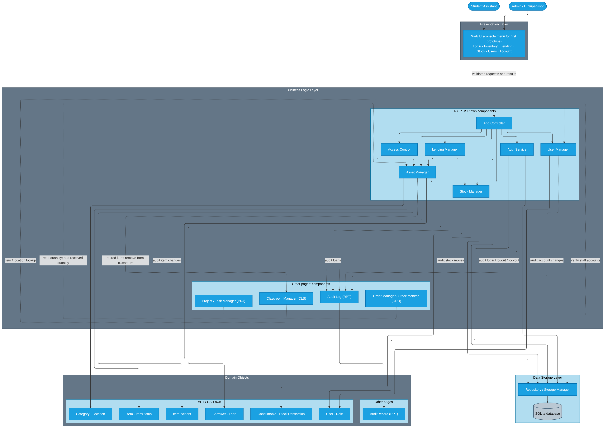

# SP4 – System Design: Assets & Lending (AST), Login & Users (USR)

**Owner:** Zafar Azatov · **Issue:** #28 (parent #27) · **Milestone:** SP4 – System Design

**Sources:** merged [`SP2_Requirements_Collection.md`](../sp2-requirements/SP2_Requirements_Collection.md) and [`SP3-User-Stories.md`](../sp3-user-stories/SP3-User-Stories.md). All FR, NFR, BR, UC and US IDs below are the **merged** IDs, not the older page-level files.

**Out of scope:** class attributes and methods (SP5), database tables (SP6), state diagrams (SP7), sequence diagrams (SP8), and other members' page internals.

---

## 3. System Architecture



Source: [`AST-USR-components.mmd`](AST-USR-components.mmd). Solid arrows are calls inside AST/USR. Dashed arrows are calls to or from other pages' components, labeled with the reason. Like the Order and Report & Audit diagrams, each layer separates this page's own components from the ones that belong to other pages.

### 3.1 Presentation Layer

A web UI (Python 3.12 + SQLite stack from #31), with a console menu for the first prototype. Screens: Login, Inventory, Lending, Overdue Loans, Consumable Stock, Users (Admin only), and Account. Screens check field format only (required, length, date format), send the request to the App Controller, and show the result or error message. They never change items, loans or accounts directly.

### 3.2 Business Logic Layer

The **App Controller** receives every request. It asks **Access Control** whether the logged-in user's role allows the action, then calls the right manager. Managers apply the business rules, update domain objects, save through the repository, and write an audit entry. **Auth Service** and **Asset Manager** are also used by other pages for the current user/role and item lookups.

### 3.3 Data Storage Layer

Managers never touch the database. They call **Repository / Storage Manager**, which reads and writes the **SQLite database**, so data stays after the app closes. Every change is written to the shared audit log owned by RPT (A-13).

### 3.4 Domain Objects

| Group | Objects (SP2 §11) |
|---|---|
| AST / USR own | Item, ItemStatus, Category, Location, Consumable, StockTransaction, Borrower, Loan, ItemIncident, User, Role |
| Other pages' | AuditRecord (RPT) |

## 4. Main System Components

| Component | Layer | Responsibility |
|---|---|---|
| Web UI / console menu | Presentation | Show AST and USR screens, collect input, check field format, display results and errors. |
| App Controller | Business Logic | Single entry point; checks the session, asks Access Control, routes to the right manager. |
| Access Control | Business Logic | Decide whether the current role (Admin or SA) may run an action; hide and block Admin-only actions for SAs. |
| Auth Service | Business Logic | Log in and out, verify password hashes, count failed attempts, lock accounts, expire idle sessions, force temporary-password change; give other pages the current user and role. |
| User Manager | Business Logic | Create accounts, change roles, deactivate and reactivate, change own password, reset passwords; keep at least one active Admin. |
| Asset Manager | Business Logic | Register, edit, search and retire items; record Lost / Damaged incidents; own item status changes; give other pages item, location and quantity lookups. |
| Lending Manager | Business Logic | Check borrower eligibility, lend, return, extend loans, list overdue loans and loan history. |
| Stock Manager | Business Logic | Record stock-in and stock-out of consumables and keep quantity at zero or above. |
| Repository / Storage Manager | Data Storage | Save and load all AST and USR records in SQLite. |

### Cross-page interactions

| From | To | Reason | Source |
|---|---|---|---|
| Asset, Lending, Stock, User Manager, Auth Service | Audit Log (RPT) | Record user, time, old and new values for every change | FR-USR-06, BR-03 |
| Asset Manager | Classroom Manager (CLS) | A retired item is removed from its classroom | BR-18, US-AST-11 |
| Order Manager / Stock Monitor (ORD) | Asset Manager | Read consumable quantity to flag low stock; add received quantity when an order arrives | FR-AST-13, FR-AST-14, US-ORD-01, US-ORD-03 |
| Classroom Manager (CLS) | Asset Manager | Look up items and locations for classroom equipment | A-05, A-06 |
| Project / Task Manager (PRJ) | User Manager | Verify staff accounts for members and assignees | BR-14 |
| All pages | Auth Service, Access Control | Current user and role check | BR-04, FR-USR-05 |

Low-stock flagging and notifications belong to ORD and NTF (US-AST-04 notes), so AST does not call Notifications directly.

## 9. Main System Workflows

### 9.1 Lend Out an Item (US-AST-05, UC-AST-03)

1. SA opens **Lending** and chooses *Lend Out*.
2. SA enters the asset tag.
3. App Controller checks the session and that the role can lend (Access Control).
4. Lending Manager asks Asset Manager for the item. Not found → "Item not found."
5. Lending Manager checks the item is **Available** (BR-07). If not, the item's current status is shown and the flow stops.
6. SA enters the borrower's school ID. Lending Manager loads the Borrower, or the SA enters name, email and borrower type for a new one.
7. Lending Manager checks eligibility (BR-09): no overdue loan, and a student holds fewer than 2 items.
8. Lending Manager proposes the due date: today + 7 days (student) or + 30 days (faculty/staff) (BR-08). An SA-changed date must stay within that length.
9. SA records condition out (Good / Fair / Poor + notes) and confirms.
10. Lending Manager creates the Loan (Open, processed by the SA); Asset Manager sets the item to **On Loan**.
11. Repository saves loan, borrower and item together. If the save fails, nothing is kept and the item stays Available.
12. Lending Manager writes the audit entry.
13. Screen shows a confirmation with the due date and returns to the Lending screen.

### 9.2 Record an Item Return (US-AST-06, UC-AST-03)

1. SA opens **Lending** and chooses *Return*.
2. SA enters the asset tag.
3. App Controller checks the session and role.
4. Lending Manager finds the item's open loan. None → "No open loan for this item."
5. Screen shows borrower, checkout date and due date.
6. SA enters return date (default today), condition in and notes.
7. Lending Manager checks the return date is not before the checkout date.
8. Lending Manager closes the loan with the return date and the SA as receiver. The loan is kept, never deleted (BR-02).
9. Asset Manager sets the item to **Available**, or **Damaged** if returned damaged (BR-10).
10. Repository saves loan and item together.
11. Lending Manager writes the audit entry.
12. Screen shows the confirmation, the new item status, and days overdue if late.

### 9.3 Log In (US-USR-01, UC-USR-01)

1. User opens the **Login** screen.
2. User enters school email and password.
3. Screen checks both fields are filled.
4. App Controller sends the credentials to Auth Service.
5. Auth Service loads the User through the repository.
6. Account locked → "Account locked. Try again in 15 minutes." Account deactivated → same generic message as a wrong password (BR-04, NFR-USR-03).
7. Unknown email or wrong password → "Invalid email or password." The failed count goes up for an existing account.
8. On the 5th consecutive failure, the account is locked for 15 minutes (FR-USR-07).
9. On success: failed count reset, last login saved, session started with a 30-minute idle timeout (NFR-USR-02).
10. Temporary password → user must set a new one before continuing (FR-USR-09).
11. Auth Service writes the audit entry.
12. App Controller opens the dashboard; Access Control hides Admin-only actions for an SA.

### 9.4 Other flows

| Flow | Steps |
|---|---|
| Log out (US-USR-01) | Click Log out → Auth Service ends the session → audit → login screen. |
| Register item (US-AST-01) | Enter fields → screen checks required fields → Asset Manager checks asset tag unique, including Retired items (BR-01) → save as Available → audit. |
| Edit item (US-AST-02) | Open item → Retired items are read-only (BR-07) → change fields → tag still unique → save → audit with old and new values. |
| Search inventory (US-AST-03) | Enter tag / serial / model and filters → Asset Manager queries → items matching all values, or "No items found." |
| Track consumable stock (US-AST-04) | Pick consumable → stock-in or stock-out with quantity (and recipient for stock-out) → Stock Manager checks quantity ≥ 0 (BR-11) → save StockTransaction → audit. |
| Extend a loan (US-AST-07) | Pick open loan → Lending Manager checks it was not extended before → new due date up to +7 days (BR-08) → save → audit. |
| View overdue loans (US-AST-08) | Lending Manager lists open loans due before today → borrower, contact, item, due date, days overdue. |
| View loan history (US-AST-09) | Pick item or borrower → Lending Manager lists all loans, including Retired items. |
| Report lost / damaged (US-AST-10) | Pick item (not Retired) → type, description, date → Asset Manager saves ItemIncident and sets status → audit. |
| Retire item (US-AST-11) | Admin only → reason and date → Asset Manager sets Retired, read-only → Classroom Manager (CLS) removes it from its room → audit. |
| Change own password (US-USR-02) | Current + new password → User Manager checks password rule (BR-06) → save hash → audit. |
| Reset password (US-USR-03) | Admin only → pick user → temporary password → must change at next login → audit. |
| Create account (US-USR-04) | Admin only → name, email, school ID, role, optional access end date → User Manager checks unique email / ID (BR-04) → save Active → audit. |
| Change role / status (US-USR-05) | Admin only → pick user → User Manager checks one active Admin remains (BR-05) → save → audit. No delete (BR-02). |
| Restrict by role (US-USR-06) | Every request → Access Control checks role → Admin-only actions hidden and blocked for SAs. |

## 11. Validation and Error Handling

### 11.1 What is checked and the messages

| Where | Check | Rule | Message |
|---|---|---|---|
| Screen | Required fields filled | NFR-AST-03 | "{Field} is required." (inline) |
| Screen | Dates are valid (YYYY-MM-DD) | NFR-AST-03 | "Enter a valid date (YYYY-MM-DD)." |
| Asset Manager | Asset tag unique, including Retired items | BR-01, FR-AST-02 | "Asset tag already exists." |
| Asset Manager | Asset tag exists | UC-AST-03 2a | "Item not found." |
| Asset Manager | Warranty end not before purchase date | FR-AST-01 | "Warranty end date cannot be earlier than the purchase date." |
| Asset Manager | Item not Retired when editing, lending or reporting | BR-07 | "Retired items are read-only." |
| Asset Manager | Lost / Damaged report has a description | US-AST-10 | "Description is required." |
| Lending Manager | Item is Available | BR-07 | "Item is {status} and cannot be lent." |
| Lending Manager | Borrower has no overdue loan | BR-09 | "Borrower has an overdue item: {asset tag}." |
| Lending Manager | Student holds fewer than 2 items | BR-09 | "Borrowing limit reached." |
| Lending Manager | Due date after checkout and within max loan length | BR-08 | "Due date must be within {7 / 30} days of checkout." |
| Lending Manager | Return date not before checkout date | US-AST-06 | "Return date cannot be earlier than the checkout date." |
| Lending Manager | Item has an open loan when returning | US-AST-06 | "No open loan for this item." |
| Lending Manager | Loan not already extended | BR-08 | "This loan has already been extended." |
| Lending Manager | Consumables are not lent | BR-11 | "Consumables are issued, not lent." |
| Stock Manager | Quantity is a whole number > 0 | US-AST-04 | "Quantity must be a positive whole number." |
| Stock Manager | Stock-out ≤ quantity on hand | BR-11 | "Not enough stock." |
| Auth Service | Credentials valid and account active | BR-04, NFR-USR-03 | "Invalid email or password." |
| Auth Service | Account not locked | FR-USR-07 | "Account locked. Try again in 15 minutes." |
| Auth Service | Session idle < 30 min | NFR-USR-02 | "Session expired. Please log in again." |
| User Manager | Email and school ID unique | BR-04 | "An account with this email or school ID already exists." |
| User Manager | Password ≥ 10 chars with letters and digits | BR-06 | "Password must be at least 10 characters and include letters and digits." |
| User Manager | At least one active Admin remains | BR-05 | "At least one active Admin is required." |
| Access Control | Role allows the action | FR-USR-05, BR-05 | "Access denied." |
| Access Control | User is logged in | BR-04 | "Please log in to continue." |

### 11.2 How errors travel

1. The screen checks format and shows inline errors without calling the controller.
2. Managers check business rules and return the message above; nothing is saved.
3. A failed save rolls back the whole action and shows "Could not save. Please try again."
4. Only successful actions are written to the audit log.

### 11.3 Permissions

| Action | SA | Admin |
|---|---|---|
| Log in / out, change own password | ✓ | ✓ |
| Register, edit, search items | ✓ | ✓ |
| Lend, return, extend, overdue list, loan history | ✓ | ✓ |
| Stock-in / stock-out consumables | ✓ | ✓ |
| Report lost / damaged | ✓ | ✓ |
| Retire item | — | ✓ |
| Create account, change role or status, reset password | — | ✓ |

## 12. User Interface Design

### 12.1 Screens

| Screen | Who | Operations |
|---|---|---|
| Login | All | Log in |
| Inventory | All | Search / filter, Register, Edit, Report lost / damaged, Retire (Admin) |
| Lending | All | Lend out, Return, Extend, Loan history |
| Overdue Loans | All | View overdue list |
| Consumable Stock | All | Stock-in, Stock-out |
| Users | Admin | Create, Change role, Deactivate / Reactivate, Reset password |
| Account | All | Change own password, Log out |

### 12.2 How each operation behaves

Every operation follows the same pattern: show the required fields → validate input → call the manager → show the result or error → return to the menu.

| Operation | Input | Validate | Call | Result shown |
|---|---|---|---|---|
| Log in | email, password | filled; credentials; active; not locked | Auth Service | Dashboard, or error |
| Log out | — | — | Auth Service | Login screen |
| Register item | tag, serial, model, manufacturer, category, location, purchase date, warranty end, notes | required fields; dates; tag unique | Asset Manager | Item saved as Available |
| Edit item | changed fields | not Retired; tag unique | Asset Manager | Updated item |
| Search inventory | tag / serial / model, category, location, status | — | Asset Manager | Result table, or "No items found." |
| Lend out | tag, borrower ID (+ name, email, type if new), due date, condition out | Available; eligible; due date | Lending Manager | Loan with due date |
| Return | tag, return date, condition in, notes | open loan; return date | Lending Manager | Loan closed; new item status |
| Extend loan | loan, new due date | open; not extended; ≤ +7 days | Lending Manager | New due date |
| Overdue loans | — | — | Lending Manager | Borrower, contact, item, due date, days overdue |
| Loan history | item or borrower | exists | Lending Manager | All loans with dates and conditions |
| Stock-in / out | consumable, quantity, recipient (out) | quantity > 0; stock ≥ 0 | Stock Manager | New quantity |
| Report lost / damaged | item, type, description, date | description; not Retired | Asset Manager | Status Lost / Damaged |
| Retire item | item, reason, date | Admin | Asset Manager | Status Retired, read-only |
| Create account | name, email, school ID, role, access end date | Admin; unique | User Manager | Active account |
| Change role / status | user, role or status | Admin; one active Admin | User Manager | Updated user |
| Change own password | current, new password | password rule | User Manager | "Password changed." |
| Reset password | user, temporary password | Admin; password rule | User Manager | Temporary password set |

### 12.3 Console menu (first prototype)

```
=== IT Inventory Tracker ===          (after login)
1. Search inventory
2. Register item
3. Edit item
4. Lend out item
5. Return item
6. Extend loan
7. View overdue loans
8. View loan history
9. Stock-in / stock-out consumable
10. Report lost or damaged item
11. Retire item                  [Admin]
12. Manage users                 [Admin]
13. Change my password
0. Log out
```

## 14. Design Traceability

Test IDs are proposed here; the merged SP2/SP3 documents do not define them.

| User Story | Use Case | Components | Test |
|---|---|---|---|
| US-AST-01 Register an Item | UC-AST-01 | Inventory, App Controller, Asset Manager, Repository, Audit Log | TC-AST-01 |
| US-AST-02 Edit Item Details | UC-AST-01 | Inventory, App Controller, Asset Manager, Repository, Audit Log | TC-AST-02 |
| US-AST-03 Search and Filter Inventory | UC-AST-02 | Inventory, App Controller, Asset Manager, Repository | TC-AST-03 |
| US-AST-04 Track Consumable Stock | UC-AST-05 | Consumable Stock, App Controller, Stock Manager, Repository, Audit Log | TC-AST-04 |
| US-AST-05 Lend Out an Item | UC-AST-03 | Lending, App Controller, Lending Manager, Asset Manager, Repository, Audit Log | TC-AST-05 |
| US-AST-06 Record an Item Return | UC-AST-03 | Lending, App Controller, Lending Manager, Asset Manager, Repository, Audit Log | TC-AST-06 |
| US-AST-07 Extend a Loan | UC-AST-03 | Lending, App Controller, Lending Manager, Repository, Audit Log | TC-AST-07 |
| US-AST-08 View Overdue Loans | UC-AST-04 | Overdue Loans, App Controller, Lending Manager, Repository | TC-AST-08 |
| US-AST-09 View Loan History | UC-AST-03 | Lending, App Controller, Lending Manager, Repository | TC-AST-09 |
| US-AST-10 Report an Item Lost or Damaged | UC-AST-06 | Inventory, App Controller, Asset Manager, Repository, Audit Log | TC-AST-10 |
| US-AST-11 Retire an Item | UC-AST-01 | Inventory, App Controller, Access Control, Asset Manager, Classroom Manager (CLS), Repository, Audit Log | TC-AST-11 |
| US-USR-01 Log In and Log Out | UC-USR-01 | Login, App Controller, Auth Service, Repository, Audit Log | TC-USR-01 |
| US-USR-02 Change My Own Password | UC-USR-03 | Account, App Controller, User Manager, Repository, Audit Log | TC-USR-02 |
| US-USR-03 Reset a User's Password | UC-USR-03 | Users, App Controller, Access Control, User Manager, Repository, Audit Log | TC-USR-03 |
| US-USR-04 Create a User Account | UC-USR-02 | Users, App Controller, Access Control, User Manager, Repository, Audit Log | TC-USR-04 |
| US-USR-05 Change a User's Role or Status | UC-USR-02 | Users, App Controller, Access Control, User Manager, Repository, Audit Log | TC-USR-05 |
| US-USR-06 Restrict Actions by Role | UC-USR-01 | App Controller, Access Control | TC-USR-06 |

## 16. Definition of Complete (this part)

- [x] Component diagram with the four layers, own vs. other pages' components, and labeled dashed cross-page calls
- [x] One line of responsibility per component
- [x] Numbered workflows for Lend, Return and Log in; short flows for every other story
- [x] Screens and operation behavior (input → validate → call → result)
- [x] Validation checks with exact messages, tied to merged business rules
- [x] All 17 merged AST/USR stories traced to a use case and components
- [x] Interface, business logic and storage are separate
