# SP4 – System Design: Classrooms & Schedules (CLS), Issue Logs (ISS)

**Course:** CS487 – Object-Oriented Design and Analysis
**Milestone:** SP4 – System Design
**Owner:** Nusratilloh Soliev (@nusratillokh-dev)
**Pages covered:** Classrooms & Schedules (`CLS`), Issue Logs (`ISS`)
**Sources:** `docs/sp2-requirements/SP2_Requirements_Collection.md` (FR, NFR, BR, A, UC IDs), `docs/sp3-user-stories/SP3-User-Stories.md` (US IDs), `docs/sp2-requirements/design-decisions.md` (DD IDs)
**Guidance:** Canvas module *Project Guidance: System Design for the Library Management System* (Sections 1–17), applied to our IT Inventory Tracker.

All IDs below use the **merged** SP2/SP3 numbering. Section 18 maps them to the older page-level IDs in `CLS-ISS-requirements.md` and `CLS-ISS-user-stories.md`.

## Contents

1. [Purpose of the System Design](#1-purpose-of-the-system-design)
2. [Design Goals](#2-design-goals)
3. [System Architecture](#3-system-architecture)
4. [Main System Components](#4-main-system-components)
5. [Domain Classes](#5-domain-classes)
6. [Class Relationships](#6-class-relationships)
7. [Applying Object-Oriented Principles](#7-applying-object-oriented-principles)
8. [Use-Case-to-Design Mapping](#8-use-case-to-design-mapping)
9. [Main System Workflows](#9-main-system-workflows)
10. [Data Storage Design](#10-data-storage-design)
11. [Validation and Error Handling](#11-validation-and-error-handling)
12. [User Interface Design](#12-user-interface-design)
13. [UML Diagrams](#13-uml-diagrams)
14. [Design Traceability](#14-design-traceability)
15. [Design Constraints](#15-design-constraints)
16. [Definition of a Complete System Design](#16-definition-of-a-complete-system-design)
17. [Recommended Implementation Order](#17-recommended-implementation-order)
18. [ID Mapping and Open Questions](#18-id-mapping-and-open-questions)

---

## 1. Purpose of the System Design

This document explains how the CLS and ISS pages will be organized and built. It turns the approved user stories (US-CLS-01 to 08, US-ISS-01 to 07) and use cases (UC-CLS-01 to 05, UC-ISS-01 to 04) into:

- system components and the layer each one belongs to
- classes, their attributes, methods and responsibilities
- storage tables
- page and menu designs
- step-by-step workflows
- validation rules and error messages
- UML diagrams (use case, class, sequence, activity, component, state)

The design stays small enough for one semester and reuses the shared classes from the other pages instead of redefining them.

## 2. Design Goals

The CLS and ISS pages should:

- Keep an accurate list of classrooms and the PCs and monitors installed in each one.
- Show each room's real condition (Available, Limited, Unusable, Closed) derived from its equipment.
- Load the class schedule from the registrar CSV, allow manual fixes, and show room timetables.
- Let an SA record an issue in under 1 minute (NFR-ISS-01) and move it through a fixed set of statuses (BR-23).
- Keep equipment condition and issue status in step automatically, in one transaction (NFR-ISS-05).
- Never delete classrooms, schedule entries, issues or issue history (BR-02, NFR-ISS-04).
- Write every change to the shared audit log with user, time, old/new value and reason (BR-03).
- Separate user interface, business logic and storage (NFR-CLS-03).
- Show encapsulation, abstraction, inheritance and polymorphism in a natural way.
- Be easy to unit-test: business rules live in plain Python classes with no UI or database code.

## 3. System Architecture

The pages use the same three-layer architecture as the rest of the project.

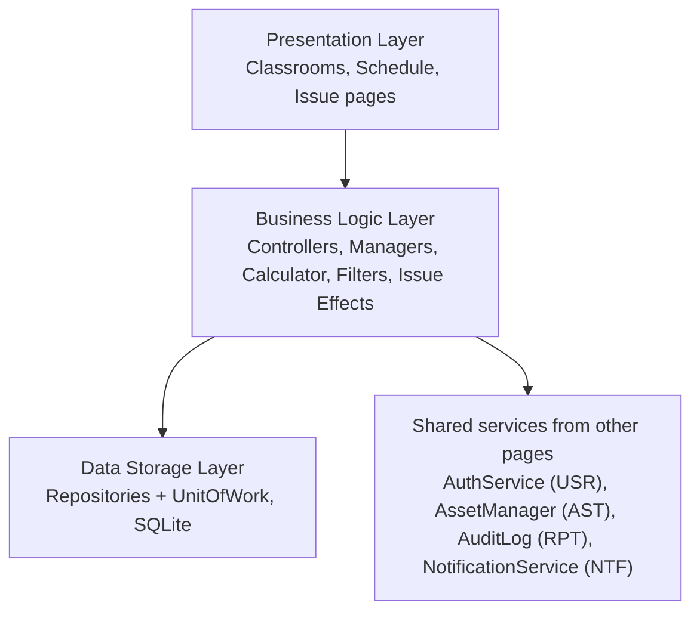

Detailed architecture (same layout as the course template – actors, presentation, business logic with own and borrowed components, storage, domain objects):

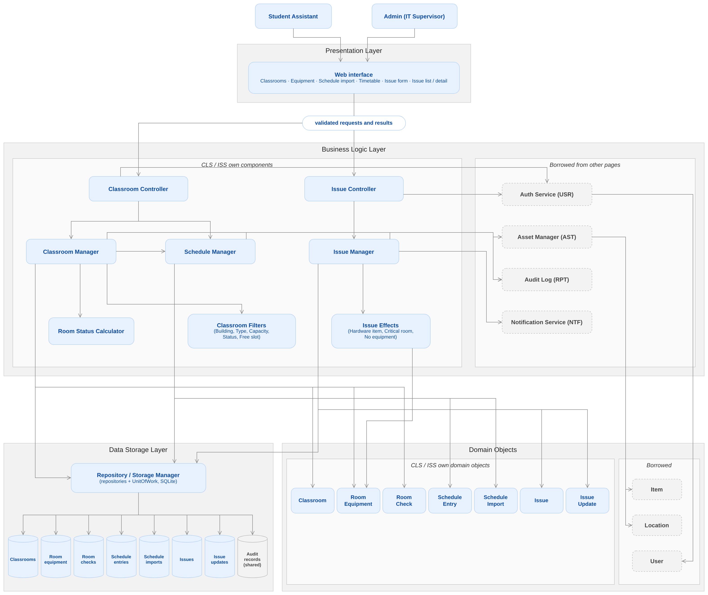

Editable source: [`CLS-ISS-architecture.drawio`](CLS-ISS-architecture.drawio)

**Proposed technology (confirm with the team):** Python 3 (project language), Flask with HTML templates for the web pages (NFR-CLS-02 requires browser pages), SQLite through the standard `sqlite3` module for storage. The business logic layer does not import Flask or `sqlite3`, so the same classes can also run behind a simple console menu for the first prototype (Section 12.3).

### 3.1 Presentation Layer

Pages: Classroom list, Classroom detail, Classroom form, Schedule import, Schedule entry form, Room timetable, Report issue form, Issue list, Issue detail (Section 12).

Responsibilities:

- Show lists, forms, filters, confirmations and error messages.
- Do basic format checks (required field present, number is a number, time is HH:MM) so the user gets instant feedback.
- Send the request to a controller and show the result.
- Show error messages next to the field they belong to (NFR-ISS-03) and keep what the user typed.

The presentation layer never changes a `Classroom`, `RoomEquipment`, `ScheduleEntry` or `Issue` directly and never talks to the database.

### 3.2 Business Logic Layer

**Own components:** `ClassroomController`, `IssueController`, `ClassroomManager`, `ScheduleManager`, `IssueManager`, `RoomStatusCalculator`, `ClassroomFilter` subclasses, `IssueEffect` subclasses.

Responsibilities:

- Check that the user is logged in and has the right role (Admin-only actions in Section 11.3).
- Enforce the business rules: one classroom per Location (BR-18), no overlapping schedule entries (BR-19), 7-day room checks (BR-20), issue fields and severity (BR-21, BR-22), allowed issue transitions (BR-23).
- Derive classroom status from equipment (DD-CLS-02).
- Apply the automatic equipment and room changes caused by issues (DD-ISS-01).
- Open and commit a transaction so an issue change and the equipment change are saved together (NFR-ISS-05).
- Call the shared audit log and notification services.

**Borrowed components:** `AuthService` (USR – current user and role), `AssetManager` (AST – item and location lookup), `AuditLog` (RPT – write audit records), `NotificationService` (NTF – issue and repeat-problem notifications).

### 3.3 Data Storage Layer

- One repository class per aggregate: `ClassroomRepository`, `RoomEquipmentRepository`, `RoomCheckRepository`, `ScheduleRepository`, `IssueRepository`.
- `UnitOfWork` wraps one SQLite transaction (`begin`, `commit`, `rollback`).
- Loads records when a page asks for them and saves them when a manager changes them. No record is ever deleted (Section 10).
- Shared tables (`items`, `locations`, `users`, `audit_records`) belong to the AST, USR and RPT pages and are only read or appended to here.

## 4. Main System Components

| Component | Layer | Responsibility | Used by stories |
|---|---|---|---|
| Classroom pages | Presentation | List, detail, form, equipment table, room-check form | US-CLS-01 – 05 |
| Schedule pages | Presentation | CSV upload, entry form, day/week timetable | US-CLS-06 – 08 |
| Issue pages | Presentation | Report form, filtered list, detail with history | US-ISS-01 – 07 |
| `ClassroomController` | Business | Receives classroom and schedule requests, checks role, maps errors to messages | CLS |
| `IssueController` | Business | Receives issue requests, checks role, maps errors to messages | ISS |
| `ClassroomManager` | Business | Classroom CRUD (no delete), equipment move/remove/condition, room checks, search | US-CLS-01 – 05 |
| `ScheduleManager` | Business | CSV import, manual entries, overlap check, timetable, free-slot check | US-CLS-05 – 08 |
| `IssueManager` | Business | Create, search, change status, comment, resolve, duplicate, history | US-ISS-01 – 07 |
| `RoomStatusCalculator` | Business | Derives AVAILABLE / LIMITED / UNUSABLE / CLOSED | US-CLS-03, US-ISS-05 |
| `ClassroomFilter` family | Business | One class per search criterion; combined with AND | US-CLS-05 |
| `IssueEffect` family | Business | Equipment/room side-effects of an issue (strategy per issue type) | US-ISS-01, US-ISS-05 |
| Repositories + `UnitOfWork` | Storage | Load/save records; one transaction per business operation | all |
| `AuthService` (USR) | Borrowed | Current user, role check | all |
| `AssetManager` (AST) | Borrowed | Item and Location lookup | US-CLS-01, 02 |
| `AuditLog` (RPT) | Borrowed | Append-only audit records | all changes |
| `NotificationService` (NTF) | Borrowed | Issue reported, repeat problem flagged | US-ISS-01, 06 |

## 5. Domain Classes

All attributes are private (leading underscore in Python) and are changed only through the methods listed. Shared classes `User`, `Role`, `Item`, `ItemStatus`, `Location`, `AuditRecord` come from the USR, AST and RPT pages and are not redefined.

### 5.1 Classroom

Represents one teaching room. One `Classroom` per `Location` (BR-18).

| Attribute | Type | Notes |
|---|---|---|
| classroomId | str | `CLS-0001`, never reused (BR-01) |
| location | Location | building + room, from AST |
| capacity | int | > 0 |
| roomType | RoomType | LECTURE or COMPUTER_LAB |
| isActive | bool | false after deactivation |
| closedForMaintenance | bool | Admin override or Critical room issue |
| closedReason | str | required when closed |
| lastCheckedAt | datetime \| None | None = never checked |

| Method | What it does |
|---|---|
| `update(capacity, roomType)` | Validates and changes editable fields |
| `deactivate(hasEquipment, hasFutureClasses)` | Refuses if either flag is true (BR-18); otherwise `isActive = False` |
| `closeForMaintenance(reason)` / `reopen()` | Sets or clears the closed override |
| `recordCheck(checkedAt)` | Updates `lastCheckedAt` |
| `isCheckOverdue(today, intervalDays=7)` | True if never checked or last check older than 7 days (BR-20) |
| `displayName()` | "Building – Room" |

### 5.2 RoomEquipment

Links one installed PC or monitor (`Item`) to a classroom and holds its condition. Condition is separate from the AST `ItemStatus` (DD-CLS-01, A-06).

| Attribute | Type | Notes |
|---|---|---|
| roomEquipmentId | str | |
| classroomId | str | |
| itemId | str | AST item, category Desktop or Monitor |
| seatLabel | str | optional, e.g. "R2-S5" |
| condition | EquipmentCondition | WORKING, FAULTY, UNDER_REPAIR, OUT_OF_SERVICE, MISSING (A-07) |
| installedAt / removedAt | datetime | `removedAt = None` means still installed |
| updatedBy / updatedAt | str / datetime | last change |
| version | int | optimistic locking (two users editing at once) |

| Method | What it does |
|---|---|
| `isInstalled()` | `removedAt is None` |
| `setCondition(newCondition, reason, user)` | Requires reason; raises `NoChange` if same value; returns old value for the audit record |
| `remove(user, at)` | Sets `removedAt`; the record stays as history |

A move is `remove()` on the old record plus a new `RoomEquipment` in the target room with the same condition.

### 5.3 RoomCheck and RoomCheckResult

`RoomCheck` records one check of a room by an SA: `checkId`, `classroomId`, `checkedBy`, `checkedAt`, `notes`, `results`. Method `addResult(roomEquipmentId, observedCondition, comment)`.
`RoomCheckResult` holds one observed condition per installed item: `resultId`, `roomEquipmentId`, `observedCondition`, `comment`.

### 5.4 ScheduleEntry

One weekly class meeting.

| Attribute | Type | Notes |
|---|---|---|
| entryId | str | |
| classroomId | str | |
| courseCode, courseTitle, instructorName | str | required |
| dayOfWeek | DayOfWeek | MON … SUN |
| startTime, endTime | time | `endTime > startTime` |
| termStart, termEnd | date | `termEnd >= termStart` |
| status | EntryStatus | ACTIVE or CANCELLED |
| source | EntrySource | IMPORT or MANUAL |
| importId | str \| None | set when imported |
| createdBy / createdAt | str / datetime | |

| Method | What it does |
|---|---|
| `validate()` | Required fields, valid times and dates |
| `overlaps(other)` | Same room, same day, both ACTIVE, term ranges intersect and time ranges intersect (BR-19) |
| `occursOn(day)` | ACTIVE, weekday matches, `termStart <= day <= termEnd` |
| `update(fields)` | Changes fields then re-validates |
| `cancel()` | `status = CANCELLED`; kept for history (BR-19) |

### 5.5 ScheduleImport

One CSV import: `importId`, `fileName`, `importedBy`, `importedAt`, `rowsAccepted`, `rowsRejected`, `rejectedRows` (row number + reason). Methods `accept(entry)` and `reject(rowNumber, reason)` keep the counts correct.

### 5.6 Issue

One reported problem in a classroom, optionally for one installed PC or monitor (BR-21).

| Attribute | Type | Notes |
|---|---|---|
| issueId | str | `ISS-00001`, never reused |
| classroomId | str | required |
| roomEquipmentId | str \| None | must be installed in that classroom |
| category | IssueCategory | HARDWARE, SOFTWARE, NETWORK, ROOM_FACILITY, OTHER |
| severity | Severity | LOW, MEDIUM, HIGH, CRITICAL |
| description | str | required |
| status | IssueStatus | starts OPEN |
| reporterName | str | required |
| reporterType | ReporterType | STUDENT, FACULTY, STAFF |
| reporterContact | str | optional |
| createdBy / createdAt | str / datetime | set automatically (FR-ISS-03) |
| assignedTo | str \| None | set by Admin |
| targetDate | date | createdAt + 1/3/7/14 days by severity (BR-22) |
| resolutionNotes, resolvedBy, resolvedAt | | required to resolve (BR-23) |
| duplicateOfId | str \| None | required when DUPLICATE |
| isRepeatProblem | bool | set when reports > 3 (FR-ISS-08) |
| version | int | optimistic locking |
| history | list[IssueUpdate] | append-only |

| Method | What it does |
|---|---|
| `create(form, user, now)` (static) | Validates required fields and builds an OPEN issue with target date |
| `allowedNextStatuses(user)` | Statuses allowed from the current one for this role – used to build the status menu |
| `changeStatus(newStatus, user, note)` | Checks BR-23 and role, then appends an `IssueUpdate` |
| `assign(assignee, admin)` | OPEN → ASSIGNED, Admin only |
| `resolve(notes, user)` | IN_PROGRESS → RESOLVED, notes required |
| `markDuplicate(original, user)` | OPEN/ASSIGNED → DUPLICATE, link to original |
| `addComment(text, user)` | Appends a comment `IssueUpdate`; empty text refused |
| `isFinal()` | CLOSED, REJECTED or DUPLICATE |
| `isUnresolved()` | OPEN, ASSIGNED or IN_PROGRESS |
| `isOverdue(today)` | `isUnresolved()` and `today > targetDate` |

### 5.7 IssueUpdate

Immutable history line: `updateId`, `issueId`, `userId`, `timestamp`, `oldStatus`, `newStatus`, `comment`. A status change has old/new status; a comment has only `comment`. There is no edit or delete method (NFR-ISS-04).

### 5.8 Enumerations

| Enum | Values |
|---|---|
| RoomType | LECTURE, COMPUTER_LAB |
| EquipmentCondition | WORKING, FAULTY, UNDER_REPAIR, OUT_OF_SERVICE, MISSING |
| RoomStatus (derived) | AVAILABLE, LIMITED, UNUSABLE, CLOSED |
| EntryStatus / EntrySource | ACTIVE, CANCELLED / IMPORT, MANUAL |
| IssueCategory | HARDWARE, SOFTWARE, NETWORK, ROOM_FACILITY, OTHER |
| Severity | LOW (14 days), MEDIUM (7), HIGH (3), CRITICAL (1); method `targetDays()` |
| IssueStatus | OPEN, ASSIGNED, IN_PROGRESS, RESOLVED, CLOSED, DUPLICATE, REJECTED |
| ReporterType | STUDENT, FACULTY, STAFF |

## 6. Class Relationships

- A `Location` has at most one `Classroom`; a `Classroom` belongs to exactly one `Location`.
- A `Classroom` has many `RoomEquipment` records over time; only those with `removedAt = None` are installed now.
- An `Item` has many `RoomEquipment` records over time but at most one installed at a time.
- A `Classroom` has many `RoomCheck`s; a `RoomCheck` is composed of many `RoomCheckResult`s (deleted together – composition).
- A `Classroom` has many `ScheduleEntry`s; a `ScheduleImport` created many of them.
- A `Classroom` has many `Issue`s; a `RoomEquipment` may have many `Issue`s.
- An `Issue` is composed of many `IssueUpdate`s (its history).
- An `Issue` may point to one original `Issue` (`duplicateOf`).
- A `User` creates, is assigned, and resolves issues, writes issue updates and records room checks.

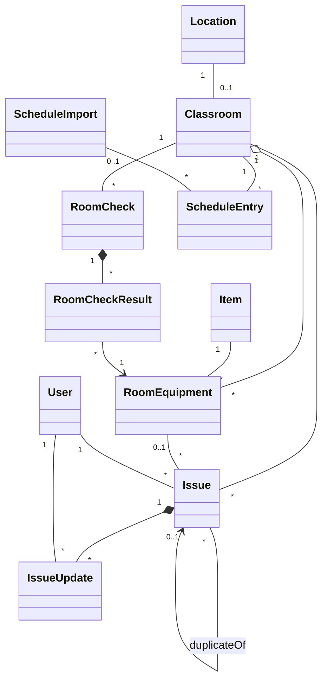

Full diagrams with attributes, methods and multiplicity:

- Domain classes: [`diagrams/class-diagram-domain.png`](diagrams/class-diagram-domain.png)
- Business-logic and storage classes: [`diagrams/class-diagram-logic.png`](diagrams/class-diagram-logic.png)

## 7. Applying Object-Oriented Principles

### Encapsulation

Every domain class keeps its data private and changes it only through methods that check the rules.

```text
Issue
  - _status : IssueStatus            (private)
  + changeStatus(newStatus, user, note)   checks BR-23 + role, writes IssueUpdate
  + allowedNextStatuses(user)

RoomEquipment
  - _condition : EquipmentCondition  (private)
  + setCondition(newCondition, reason, user)   requires reason, rejects "no change"
```

No other class can set `issue.status = CLOSED` directly, so an illegal jump such as Open → Closed is impossible by design.

### Abstraction

The presentation layer only sees simple operations such as:

```text
issueController.createIssue(form)
issueController.resolveIssue(issueId, notes, newCondition)
classroomController.search(criteria)
```

It does not know how duplicates are found, how the target date is computed, which equipment changes happen, or how the transaction is opened. `Repository` is also an abstraction: managers call `save()` and `findById()` and do not know the SQL.

### Inheritance

Inheritance is used only where there is a real "is-a" relationship:

```text
ClassroomFilter (abstract)          IssueEffect (abstract)
├── BuildingFilter                  ├── HardwareItemEffect
├── RoomTypeFilter                  ├── CriticalRoomEffect
├── MinCapacityFilter               └── NoEquipmentEffect
├── StatusFilter
└── FreeSlotFilter
```

`Admin` and `Student Assistant` are **not** subclasses: they differ only by permissions, so the shared `User` class keeps a `Role` value (same choice as the USR page). Each repository implements the common `Repository` interface.

### Polymorphism

- **Search:** `ClassroomManager.search()` builds a list of filters from the criteria the user filled in and calls `filter.matches(summary)` on each one. It never checks which filter type it has, so a new criterion is just a new subclass.
- **Issue side-effects (Strategy pattern):** `IssueEffectFactory.effectsFor(issue)` returns the right strategy objects; `IssueManager` calls `onReported()` and `onResolved()` on each one without `if category == ...` chains.

| Strategy | `onReported(issue)` | `onStarted(issue)` (→ IN_PROGRESS) | `onResolved(issue, newCondition)` |
|---|---|---|---|
| `HardwareItemEffect` (Hardware + item) | Only a WORKING item → FAULTY | Item → UNDER_REPAIR | Set chosen condition only if no other unresolved issue on the item (FR-ISS-09) |
| `CriticalRoomEffect` (Critical + no item) | Close classroom for maintenance | nothing | Reopen if no other unresolved Critical room issue |
| `NoEquipmentEffect` (all others) | nothing | nothing | nothing |

Rules come from DD-ISS-01. Every automatic change is written to the audit log with the issue ID (BR-03).

### Design patterns used

Repository (data access), Unit of Work (NFR-ISS-05 – all-or-nothing saves), Strategy (issue effects, filters), Observer (NTF page subscribes to "issue reported" and "repeat problem" events – as in the SP1 proposal).

## 8. Use-Case-to-Design Mapping

| Use case | User stories | Controller → Manager method | Domain classes | Diagram |
|---|---|---|---|---|
| UC-CLS-01 Manage Classroom | US-CLS-01 | `ClassroomManager.addClassroom / updateClassroom / deactivateClassroom` | Classroom, Location | class |
| UC-CLS-02 Manage Classroom Equipment | US-CLS-02, US-CLS-03 | `moveEquipment / removeEquipment / setCondition` | RoomEquipment, Item, Classroom | seq-set-condition |
| UC-CLS-03 Record Room Check | US-CLS-04 | `recordRoomCheck` | RoomCheck, RoomCheckResult, Classroom | class |
| UC-CLS-04 Manage Class Schedule | US-CLS-06, US-CLS-07 | `ScheduleManager.importCsv / addEntry / editEntry / cancelEntry` | ScheduleImport, ScheduleEntry | seq-import-schedule |
| UC-CLS-05 View Classrooms | US-CLS-04, US-CLS-05, US-CLS-08 | `ClassroomManager.listClassrooms / search`, `ScheduleManager.getTimetable` | Classroom, ScheduleEntry | seq-search-classrooms |
| UC-ISS-01 Report Issue | US-ISS-01 | `IssueManager.findPossibleDuplicates / createIssue` | Issue, RoomEquipment, Classroom | seq-record-issue, act-record-issue |
| UC-ISS-02 View Issues | US-ISS-02 | `IssueManager.searchIssues` | Issue | class |
| UC-ISS-03 Handle Issue | US-ISS-03, US-ISS-04, US-ISS-05, US-ISS-07 | `changeStatus / addComment / resolveIssue / getHistory` | Issue, IssueUpdate, RoomEquipment | seq-resolve-issue, act-resolve-issue, issue-state |
| UC-ISS-04 Close Issue | US-ISS-03, US-ISS-06 | `changeStatus / markDuplicate` | Issue | issue-state |

## 9. Main System Workflows

### 9.1 Record Issue Workflow (US-ISS-01) – like "Issue Book" in the template

1. The SA selects **Report Issue**.
2. The SA selects the building and classroom; the item list is filled only with PCs and monitors installed in that classroom.
3. The SA optionally selects one item, then the category and severity.
4. The system shows open issues on the same item, or the same classroom and category. If one is the same problem, the SA adds a comment there instead and stops.
5. The SA enters the description and the reporter's name, type and contact, then submits.
6. The system checks that the classroom exists and is active, that the item (if any) is installed in it, and that classroom, category, severity, description and reporter name are filled in.
7. An `Issue` is created with a unique ID, status OPEN, the logged-in user, the time and the target date from severity.
8. A transaction starts. The issue is saved.
9. The issue's effect strategy runs: a Hardware issue on a Working item makes it FAULTY; a Critical issue without an item closes the classroom. Each automatic change is audit-logged with the issue ID.
10. The transaction commits (or rolls back completely on any failure).
11. The NTF page is told that an issue was reported.
12. The classroom status is recalculated and a confirmation with the issue ID is shown.

Diagrams: [`seq-record-issue`](diagrams/seq-record-issue.png), [`act-record-issue`](diagrams/act-record-issue.png)

### 9.2 Resolve Issue Workflow (US-ISS-05) – like "Return Book" in the template

1. The SA opens the issue and selects **Resolve**.
2. The SA enters resolution notes and picks the item's new condition (default WORKING).
3. The system checks that the issue is IN_PROGRESS and that notes are not empty.
4. A transaction starts. The issue becomes RESOLVED with `resolvedBy` and `resolvedAt`, and an `IssueUpdate` is added.
5. If the issue has an item and no other unresolved issue references it, the item gets the chosen condition; otherwise its condition is kept.
6. If this Critical issue had closed the classroom and no other unresolved Critical room issue exists, the classroom is reopened.
7. Every automatic change is audit-logged with the issue ID.
8. The transaction commits (or rolls back completely).
9. The classroom status is recalculated and the result is shown.

Diagrams: [`seq-resolve-issue`](diagrams/seq-resolve-issue.png), [`act-resolve-issue`](diagrams/act-resolve-issue.png)

### 9.3 Change Issue Status (US-ISS-03)

| From | To | Who | Extra rule |
|---|---|---|---|
| OPEN | ASSIGNED | Admin | assignee required |
| ASSIGNED | IN_PROGRESS | SA or Admin | linked item → UNDER_REPAIR |
| IN_PROGRESS | RESOLVED | SA or Admin | notes required (Section 9.2) |
| RESOLVED | IN_PROGRESS | SA or Admin | reopen |
| RESOLVED | CLOSED | Admin | final |
| OPEN or ASSIGNED | REJECTED | Admin | reason comment required; final |
| OPEN or ASSIGNED | DUPLICATE | SA or Admin | original issue required; final |

Any other move is refused with "This status change is not allowed." An SA trying an Admin-only move gets "Not allowed for your role." The status menu shows only `allowedNextStatuses(user)`. Diagram: [`issue-state-diagram`](diagrams/issue-state-diagram.png)

### 9.4 Mark Duplicate and Repeat Problems (US-ISS-06)

1. The user selects **Mark Duplicate** and picks the original issue.
2. The system checks: the issue is OPEN or ASSIGNED, the original exists and is not the same issue. If the original is itself a duplicate, the link goes to its original (so every chain points to one root).
3. The issue becomes DUPLICATE (final) and links to the original.
4. The system counts reports of the problem = 1 (original) + number of duplicates. If the count is **more than 3** and the original was not yet flagged, `isRepeatProblem = True` and `NotificationService.repeatProblemFlagged(original)` is called once.

### 9.5 Set Equipment Condition (US-CLS-03)

1. On the classroom page the SA clicks an item (1), picks a condition (2), types a reason and saves (3) – 3 clicks (NFR-CLS-01).
2. `RoomEquipment.setCondition()` refuses an empty reason and "no change".
3. The change and an audit record (old, new, reason, user, time) are saved in one transaction.
4. The classroom status is recalculated and shown.

Diagram: [`seq-set-condition`](diagrams/seq-set-condition.png)

**Room status rule (DD-CLS-02, `RoomStatusCalculator`):**

| Condition | RoomStatus |
|---|---|
| `closedForMaintenance` is true | CLOSED |
| no installed PCs, or every installed PC is WORKING | AVAILABLE |
| at least one installed PC WORKING, at least one not | LIMITED |
| installed PCs exist and none is WORKING | UNUSABLE |

Only items of category Desktop count as PCs; monitors are shown but do not change the room status. Retired items are removed from the room (BR-18) and ignored.

### 9.6 Move or Remove Equipment (US-CLS-02)

1. The SA picks an installed item and chooses **Move** (and a target active classroom) or **Remove**.
2. The current `RoomEquipment` record is closed (`removedAt = now`); for a move a new record is opened in the target room with the same condition.
3. The AST `ItemStatus` is not changed (A-06). Both room statuses are recalculated; the action is audit-logged.

### 9.7 Record Room Check and Overdue Rooms (US-CLS-04)

1. The SA opens a classroom and selects **Record Check**. The form lists every installed item with its current condition pre-selected.
2. The SA changes the condition of any item that looks different, adds comments and saves.
3. A `RoomCheck` with one `RoomCheckResult` per item is saved; any changed condition goes through `setCondition()` with reason "Room check <checkId>: <comment>".
4. `Classroom.lastCheckedAt` is updated, so the overdue flag clears.
5. The classroom list shows "Last checked" for every room and flags rooms where `isCheckOverdue(today)` is true, including "Never checked".

### 9.8 Import Class Schedule (US-CLS-06)

1. The Admin uploads the registrar CSV.
2. The system checks the file type and header row (Section 10.5).
3. For each row: find the classroom by building + room, build a `ScheduleEntry` (source IMPORT), validate it, and check overlap against active entries **and** rows already accepted from the same file.
4. Bad rows are rejected with the row number and reason; good rows are accepted.
5. Accepted entries and the `ScheduleImport` record are saved in one transaction and audit-logged.
6. The page shows "<n> rows accepted, <m> rejected" and the rejected-row list.

Diagram: [`seq-import-schedule`](diagrams/seq-import-schedule.png)

### 9.9 Add / Edit / Cancel Schedule Entry (US-CLS-07) and Timetable (US-CLS-08)

- Add/edit uses the same `validate()` and `overlaps()` checks as the import; an edit ignores the entry itself when checking overlap. A conflict is shown as "Overlaps <course> on <day> <start>–<end>."
- Cancel sets CANCELLED; the entry stays in the database but `occursOn()` is false, so it disappears from timetables.
- **Day view:** entries where `occursOn(date)` is true, sorted by start time. **Week view:** the same for Monday–Sunday of the selected week. An empty day shows "No classes scheduled."

### 9.10 Search Classrooms (US-CLS-05) – like "Search Book" in the template

1. The SA sets any of: building, room type, minimum capacity, status, free time slot (date + start + end).
2. The controller checks the criteria (capacity ≥ 0, end after start).
3. `ClassroomManager` creates one `ClassroomFilter` per filled-in criterion.
4. Active classrooms are loaded; for each one the status is calculated and every filter's `matches()` is called. `FreeSlotFilter` asks `ScheduleManager.isRoomFree()`.
5. Matching rooms are shown with name, capacity, status and last-checked date, or "No classrooms match your filters."

Diagram: [`seq-search-classrooms`](diagrams/seq-search-classrooms.png)

### 9.11 Classroom Deactivation (US-CLS-01)

Deactivation is refused with a reason if the room has installed equipment ("Remove the installed equipment first.") or active schedule entries whose `termEnd` is today or later ("This classroom has future classes."). There is no delete.

## 10. Data Storage Design

SQLite tables (snake_case columns). Dates/times are stored as ISO-8601 text. IDs are `INTEGER PRIMARY KEY AUTOINCREMENT` (never reused – BR-01) and shown with a prefix such as `CLS-0007` or `ISS-00042`. **Nothing is ever deleted**; deactivation, cancellation, removal and final statuses replace deletes (BR-02). SP6 (database design) will refine types and indexes.

### 10.1 Classrooms – `classrooms`

| Column | Type | Rules |
|---|---|---|
| classroom_id | INTEGER PK | |
| location_id | INTEGER FK → locations | **UNIQUE** (BR-18) |
| capacity | INTEGER | > 0 |
| room_type | TEXT | LECTURE / COMPUTER_LAB |
| is_active | INTEGER (0/1) | default 1 |
| closed_for_maintenance | INTEGER (0/1) | default 0 |
| closed_reason | TEXT | required when closed |
| last_checked_at | TEXT | NULL = never |
| created_by, created_at, updated_by, updated_at | | |

### 10.2 Room Equipment – `room_equipment`

| Column | Type | Rules |
|---|---|---|
| room_equipment_id | INTEGER PK | |
| classroom_id | INTEGER FK → classrooms | |
| item_id | INTEGER FK → items | partial UNIQUE index on `item_id WHERE removed_at IS NULL` (one room at a time) |
| seat_label | TEXT | optional |
| condition | TEXT | WORKING / FAULTY / UNDER_REPAIR / OUT_OF_SERVICE / MISSING |
| installed_at | TEXT | |
| removed_at | TEXT | NULL = installed |
| updated_by, updated_at | | |
| version | INTEGER | optimistic lock |

### 10.3 Room Checks – `room_checks`, `room_check_results`

| Table | Columns |
|---|---|
| room_checks | check_id PK, classroom_id FK, checked_by FK → users, checked_at, notes |
| room_check_results | result_id PK, check_id FK, room_equipment_id FK, observed_condition, comment |

### 10.4 Schedules – `schedule_entries`, `schedule_imports`

| Column (`schedule_entries`) | Type | Rules |
|---|---|---|
| entry_id | INTEGER PK | |
| classroom_id | INTEGER FK | |
| course_code, course_title, instructor_name | TEXT | NOT NULL |
| day_of_week | TEXT | MON…SUN |
| start_time, end_time | TEXT (HH:MM) | CHECK end_time > start_time |
| term_start, term_end | TEXT (date) | CHECK term_end >= term_start |
| status | TEXT | ACTIVE / CANCELLED |
| source | TEXT | IMPORT / MANUAL |
| import_id | INTEGER FK → schedule_imports | NULL for manual |
| created_by, created_at, updated_by, updated_at | | |

Index: `(classroom_id, day_of_week, status)` for overlap checks and timetables.

`schedule_imports`: import_id PK, file_name, imported_by FK, imported_at, rows_accepted, rows_rejected, rejected_rows (JSON text: row number + reason).

### 10.5 Schedule CSV format

```text
course_code,course_title,instructor,building,room,day,start_time,end_time,term_start,term_end
CS487,Object-Oriented Design,J. Smith,Main,201,TUE,14:00,15:50,2026-08-24,2026-12-11
```

`day` accepts MON–SUN or full English names; times are 24-hour HH:MM; dates are YYYY-MM-DD.

### 10.6 Issues – `issues`, `issue_updates`

| Column (`issues`) | Type | Rules |
|---|---|---|
| issue_id | INTEGER PK | |
| classroom_id | INTEGER FK | NOT NULL |
| room_equipment_id | INTEGER FK | NULL allowed |
| category | TEXT | HARDWARE / SOFTWARE / NETWORK / ROOM_FACILITY / OTHER |
| severity | TEXT | LOW / MEDIUM / HIGH / CRITICAL |
| description | TEXT | NOT NULL |
| status | TEXT | 7 values from IssueStatus |
| reporter_name | TEXT | NOT NULL |
| reporter_type | TEXT | STUDENT / FACULTY / STAFF |
| reporter_contact | TEXT | optional |
| created_by, created_at | | set by system |
| assigned_to | INTEGER FK → users | |
| target_date | TEXT | |
| resolution_notes, resolved_by, resolved_at | | |
| duplicate_of_id | INTEGER FK → issues | required when DUPLICATE |
| is_repeat_problem | INTEGER (0/1) | |
| version | INTEGER | optimistic lock |

Indexes: `status`, `classroom_id`, `room_equipment_id`, `created_at` – keeps the filtered list under 2 s for 5,000 issues (NFR-ISS-02); the list is paged 50 rows at a time.

`issue_updates` (append-only): update_id PK, issue_id FK, user_id FK, timestamp, old_status, new_status, comment. No UPDATE or DELETE is ever run on this table.

### 10.7 Shared – `audit_records` (owned by RPT)

CLS/ISS only append: user, action (e.g. `CLASSROOM_DEACTIVATED`, `CONDITION_CHANGED`, `SCHEDULE_IMPORTED`, `ISSUE_STATUS_CHANGED`), entity type, entity ID, old value, new value, reason, timestamp, and `triggered_by` (the issue ID for automatic changes – BR-03).

## 11. Validation and Error Handling

### 11.1 What is validated

| Area | Rule | Message |
|---|---|---|
| Classroom | Location, capacity, room type required; capacity > 0 | "Capacity must be a whole number greater than 0." |
| Classroom | One classroom per Location | "This room already exists as a classroom." |
| Classroom | Cannot deactivate with equipment or future classes | "Remove the installed equipment first." / "This classroom has future classes." |
| Equipment | Item must be Desktop/Monitor, not Retired, not On Loan, not already installed | "This item is already installed in <room>." |
| Equipment | Move target must be an active, different classroom | "Choose a different active classroom." |
| Condition | Reason required; value must change | "Reason is required." / "No change." |
| Schedule | Required fields; valid day/time/date | "<Field> is required." / "Invalid time – use HH:MM." |
| Schedule | End after start; term end ≥ term start | "End time must be after the start time." |
| Schedule | No overlap in same room/day/term | "Overlaps <course> on <day> <start>–<end>." |
| Import | CSV file with expected header; unknown room per row | "File must be a CSV with the expected columns." / "Row 12: room Main 999 not found." |
| Issue | Classroom, category, severity, description, reporter name required | "Description is required." (shown next to the field) |
| Issue | Item must be installed in the chosen classroom | "Item is not installed in this classroom." |
| Issue | Allowed transitions only; final statuses locked | "This status change is not allowed." |
| Issue | Notes required to resolve | "Resolution notes are required." |
| Issue | Duplicate needs an existing original, not itself | "Choose the original issue." |
| Comment | Not empty; issue not final | "Comment cannot be empty." / "This issue is closed. Comments are not allowed." |
| Reject | Reason comment required (Admin) | "Give a reason for rejecting this issue." |
| Search | Capacity ≥ 0; slot end after start | "End time must be after the start time." |
| Lookups | IDs that do not exist | "Classroom not found." / "Issue not found." |

### 11.2 How errors travel

```text
ValidationError(field, message)  -> page shows message next to field, keeps typed values
BusinessRuleError(message)       -> page shows message at the top of the form
NotFoundError(message)           -> page shows message, returns to the list
PermissionDeniedError            -> "Not allowed for your role."
ConcurrencyError                 -> "This record was changed by someone else. Reload and try again."
StorageError                     -> transaction rolled back, "Could not save. Please try again."
```

Domain classes raise these exceptions; controllers catch them and turn them into messages. Nothing is half-saved: every operation that writes more than one row uses `UnitOfWork` (NFR-ISS-05).

### 11.3 Permissions

| Action | Admin | SA |
|---|---|---|
| Add / edit / deactivate classroom | ✔ | ✘ |
| Move / remove equipment, set condition, record room check | ✔ | ✔ |
| Import schedule, add / edit / cancel entry | ✔ | ✘ |
| View classrooms, search, timetable | ✔ | ✔ |
| Record issue, comment, start work, resolve, reopen, mark duplicate | ✔ | ✔ |
| Assign, reject, close issue | ✔ | ✘ |

## 12. User Interface Design

### 12.1 Classrooms & Schedules pages

| Page | Main elements |
|---|---|
| Classroom list | Filters (building, type, min capacity, status, free slot date/start/end); table: room, type, capacity, status badge, last checked, overdue flag; "Add classroom" (Admin) |
| Classroom detail | Room info and status; equipment table (asset tag, seat, condition dropdown → reason box → Save); Move / Remove buttons; "Record check"; link to timetable; open issues in this room |
| Classroom form (Admin) | Location picker, capacity, room type; Deactivate button with reason message when refused |
| Room check form | One row per installed item: condition (pre-selected), comment; notes; Save |
| Schedule import (Admin) | File chooser, Import; result: accepted count, rejected rows table (row, reason) |
| Schedule entry form (Admin) | Course code/title, instructor, room, day, start/end, term start/end; Save / Cancel entry |
| Timetable | Room picker, Day/Week toggle, date picker; entries in time order; "No classes scheduled" |

### 12.2 Issue Logs pages

| Page | Main elements |
|---|---|
| Report issue | Classroom (required), item (installed items only), category, severity, description, reporter name/type/contact; possible-duplicates panel; Submit – 5 required fields, under 1 minute (NFR-ISS-01) |
| Issue list | Filters (status, classroom, item, category, severity, date range); table: ID, classroom, item, severity, status, created date; overdue rows highlighted; 50 per page |
| Issue detail | All fields; status buttons limited to allowed moves; Assign (Admin); Resolve dialog (notes + new condition); Mark duplicate dialog (original picker); comment box; history list in time order |

### 12.3 Console menu for the first prototype

The guidance allows a simple menu first. The same controllers are called, so the menu can later be replaced by the web pages without changing business logic.

```text
Classrooms & Issues
 1. Add Classroom                 (Admin)
 2. Edit / Deactivate Classroom   (Admin)
 3. Move or Remove Equipment
 4. Set Equipment Condition
 5. Record Room Check
 6. List Classrooms (last checked / overdue)
 7. Search Classrooms
 8. Import Schedule CSV           (Admin)
 9. Add / Edit / Cancel Schedule Entry (Admin)
10. View Room Timetable
11. Report Issue
12. List / Filter Issues
13. Change Issue Status
14. Comment on Issue
15. Resolve Issue
16. Mark Issue Duplicate
17. View Issue History
 0. Back
```

Each option: show the required fields → validate input → call the controller → show the result or error → return to the menu.

## 13. UML Diagrams

All diagrams are in [`diagrams/`](diagrams/) as PlantUML source (`.puml`) plus rendered `.png`. The architecture diagram is draw.io (`CLS-ISS-architecture.drawio`), matching the team's SP4 format.

| Required by guidance | File | Shows |
|---|---|---|
| Use-case diagram | [`use-case-diagram.png`](diagrams/use-case-diagram.png) | Admin, SA, NTF; UC-CLS-01–05, UC-ISS-01–04 with include/extend |
| Class diagram | [`class-diagram-domain.png`](diagrams/class-diagram-domain.png) | Domain classes, attributes, methods, associations, composition/aggregation, multiplicity, enums |
| Class diagram (design) | [`class-diagram-logic.png`](diagrams/class-diagram-logic.png) | Controllers, managers, filter and effect inheritance, repositories |
| Sequence – issue (record) | [`seq-record-issue.png`](diagrams/seq-record-issue.png) | US-ISS-01 |
| Sequence – return (resolve) | [`seq-resolve-issue.png`](diagrams/seq-resolve-issue.png) | US-ISS-05 |
| Sequence – search | [`seq-search-classrooms.png`](diagrams/seq-search-classrooms.png) | US-CLS-05 |
| Sequence – extra | [`seq-import-schedule.png`](diagrams/seq-import-schedule.png), [`seq-set-condition.png`](diagrams/seq-set-condition.png) | US-CLS-06, US-CLS-03 |
| Activity – issue workflow | [`act-record-issue.png`](diagrams/act-record-issue.png) | Section 9.1 |
| Activity – return workflow | [`act-resolve-issue.png`](diagrams/act-resolve-issue.png) | Section 9.2 |
| Package / component | [`component-diagram.png`](diagrams/component-diagram.png), [`CLS-ISS-architecture.png`](CLS-ISS-architecture.png) | UI → business → storage, borrowed services |
| State (extra, used again in SP7) | [`issue-state-diagram.png`](diagrams/issue-state-diagram.png) | BR-23 transitions |

### Use-case diagram

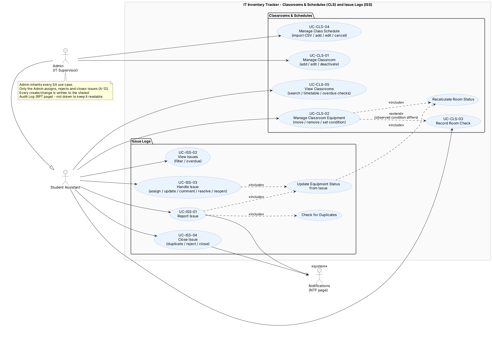

### Class diagram – domain

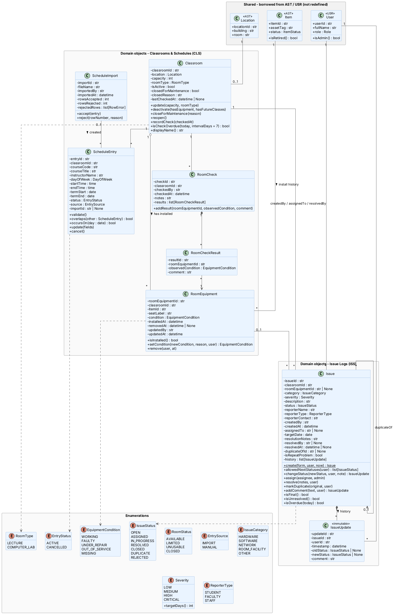

### Class diagram – business logic and storage

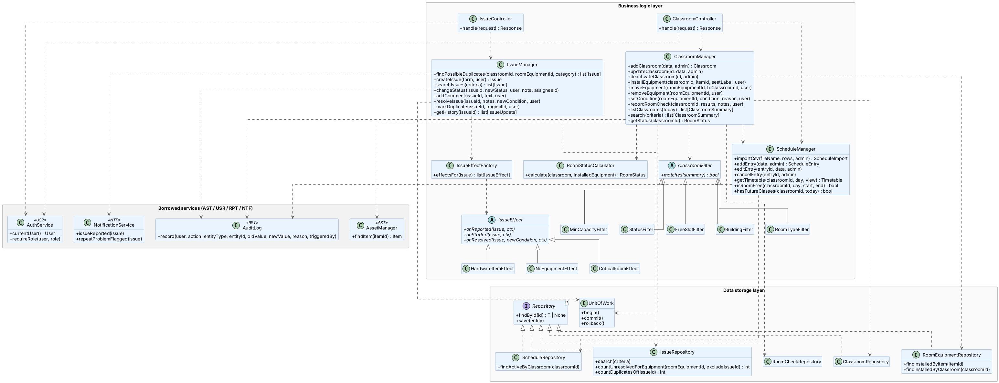

### Sequence – Record an Issue

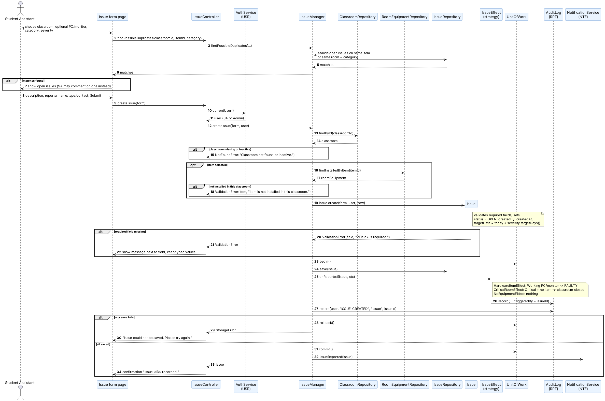

### Sequence – Resolve an Issue

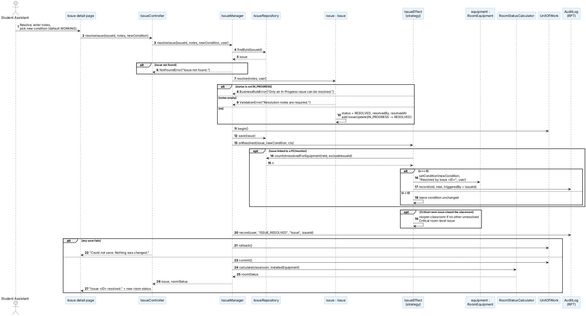

### Sequence – Search Classrooms

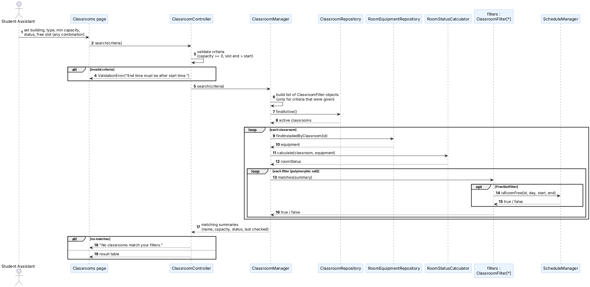

### Sequence – Import Schedule

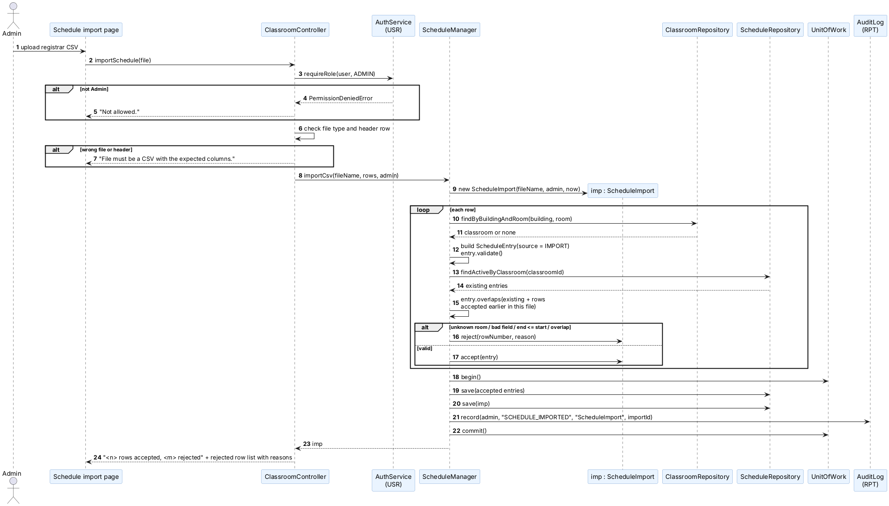

### Sequence – Set Equipment Condition

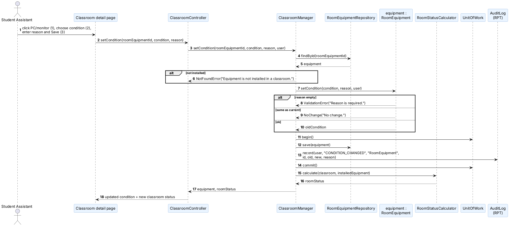

### Activity – Record an Issue

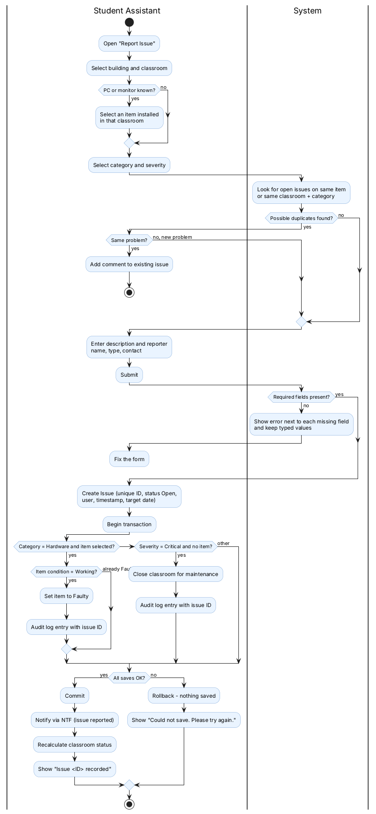

### Activity – Resolve an Issue

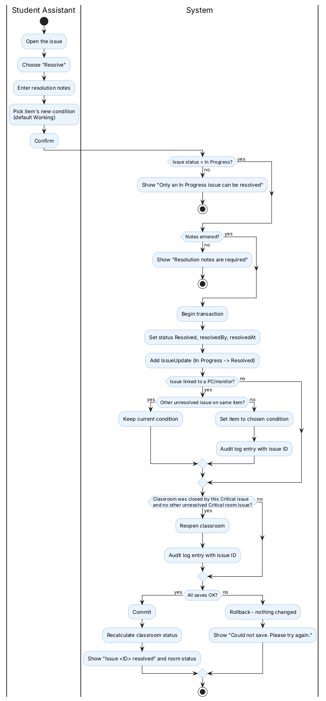

### Component diagram

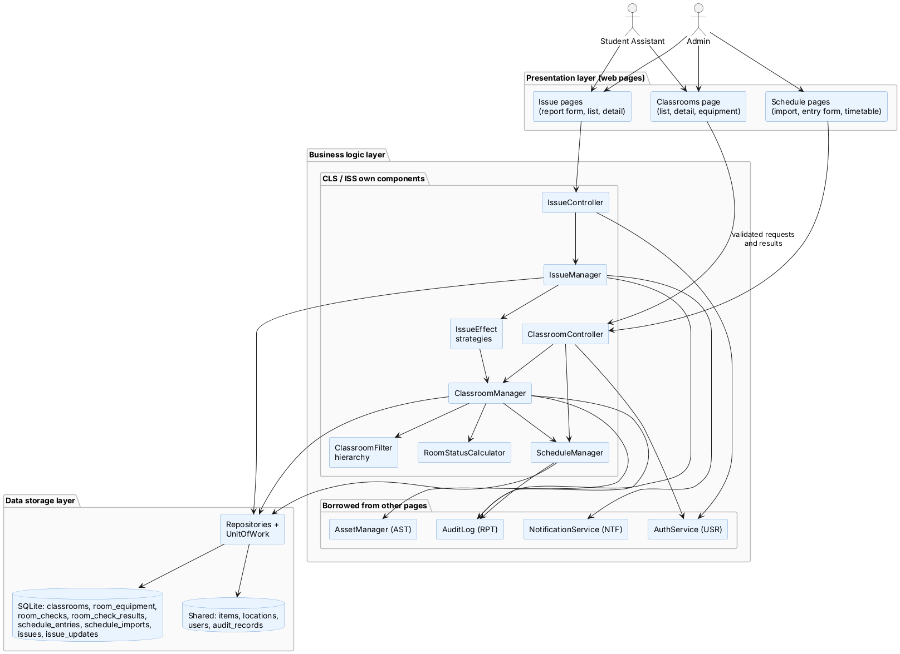

### Issue state diagram

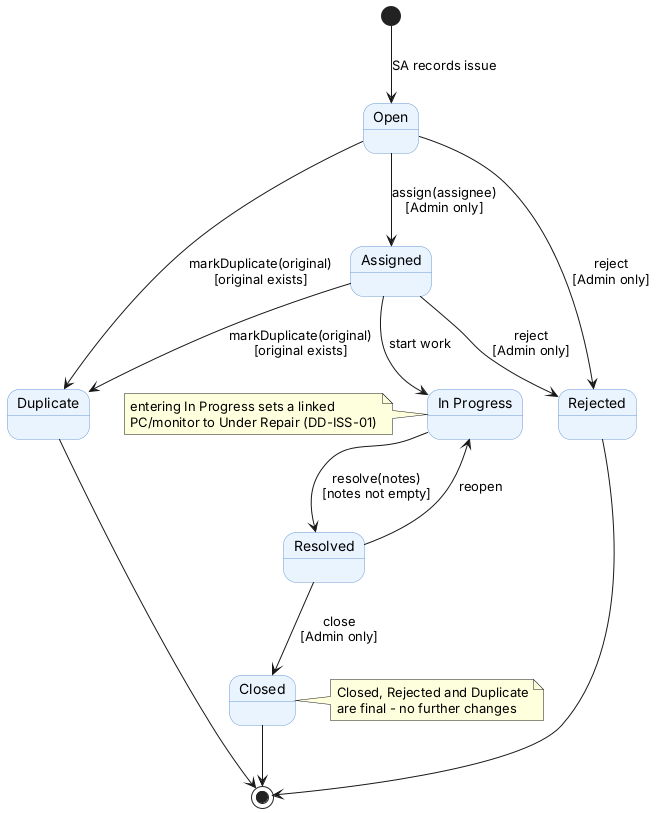

## 14. Design Traceability

| User Story | Requirement / Rule | Use Case | Main Classes | Diagram | Test |
|---|---|---|---|---|---|
| US-CLS-01 Manage Classrooms | FR-CLS-01, BR-02, BR-18 | UC-CLS-01 | ClassroomManager, Classroom, Location | class, component | TC-CLS-01 |
| US-CLS-02 Move or Remove Equipment | FR-CLS-02, BR-18, A-06 | UC-CLS-02 | ClassroomManager, RoomEquipment, Item | class | TC-CLS-02 |
| US-CLS-03 Set Equipment Condition | FR-CLS-03, FR-CLS-04, BR-03, NFR-CLS-01 | UC-CLS-02 | RoomEquipment, RoomStatusCalculator, AuditLog | seq-set-condition | TC-CLS-03 |
| US-CLS-04 Rooms Overdue for a Check | FR-CLS-05, BR-20 | UC-CLS-03, UC-CLS-05 | Classroom, RoomCheck, RoomCheckResult | class | TC-CLS-04 |
| US-CLS-05 Search and Filter Classrooms | FR-CLS-09 | UC-CLS-05 | ClassroomManager, ClassroomFilter*, ScheduleManager | seq-search-classrooms | TC-CLS-05 |
| US-CLS-06 Import Class Schedule | FR-CLS-06, BR-19, A-09 | UC-CLS-04 | ScheduleManager, ScheduleImport, ScheduleEntry | seq-import-schedule | TC-CLS-06 |
| US-CLS-07 Add/Edit/Cancel Entry | FR-CLS-07, BR-19 | UC-CLS-04 | ScheduleManager, ScheduleEntry | class | TC-CLS-07 |
| US-CLS-08 View Room Timetable | FR-CLS-08, BR-19 | UC-CLS-05 | ScheduleManager, ScheduleEntry | class | TC-CLS-08 |
| US-ISS-01 Record an Issue | FR-ISS-01–03, BR-01, BR-21, BR-22, NFR-ISS-03 | UC-ISS-01 | IssueManager, Issue, IssueEffect*, RoomEquipment | seq-record-issue, act-record-issue | TC-ISS-01 |
| US-ISS-02 List and Filter Issues | FR-ISS-04, BR-22, NFR-ISS-02 | UC-ISS-02 | IssueManager, IssueRepository, Issue | class | TC-ISS-02 |
| US-ISS-03 Change Issue Status | FR-ISS-05, BR-23, A-12 | UC-ISS-03, UC-ISS-04 | Issue, IssueUpdate | issue-state | TC-ISS-03 |
| US-ISS-04 Comments and Notes | FR-ISS-06, BR-02 | UC-ISS-03 | Issue, IssueUpdate | class | TC-ISS-04 |
| US-ISS-05 Resolve an Issue | FR-ISS-07, FR-ISS-09, BR-23, NFR-ISS-05 | UC-ISS-03 | IssueManager, Issue, HardwareItemEffect, UnitOfWork | seq-resolve-issue, act-resolve-issue | TC-ISS-05 |
| US-ISS-06 Duplicates and Repeat Problems | FR-ISS-08, BR-23 | UC-ISS-04 | IssueManager, Issue, NotificationService | issue-state | TC-ISS-06 |
| US-ISS-07 View Issue History | FR-ISS-10, BR-02, NFR-ISS-04 | UC-ISS-03 | IssueUpdate, IssueRepository | class | TC-ISS-07 |

**Planned test cases** (each checks the story's acceptance criteria; business rules are unit-tested on the domain classes without UI or database):

| Test | Checks |
|---|---|
| TC-CLS-01 | Add classroom; second classroom on same Location refused; deactivate refused with equipment / future classes; no delete |
| TC-CLS-02 | Move shows item only in new room; remove closes record; `ItemStatus` unchanged; audit record written |
| TC-CLS-03 | Empty reason refused; same condition → "No change"; audit old/new/reason; last Working PC → room UNUSABLE |
| TC-CLS-04 | Checked 8 days ago → flagged; 3 days ago → not; never → flagged; new check clears flag |
| TC-CLS-05 | Combined filters; room with class in slot not free; inactive rooms hidden; empty result message |
| TC-CLS-06 | Valid rows saved with count; unknown room / end before start / overlap rejected with reason; good rows still saved |
| TC-CLS-07 | Overlap blocked with conflicting class shown; cancelled entry kept but hidden; audit for add/edit/cancel |
| TC-CLS-08 | Day/week views in time order; cancelled hidden; "No classes scheduled" |
| TC-ISS-01 | Missing description refused naming the field; saved issue has ID, user, time, OPEN, target date; Hardware → Faulty; Software → no change; Critical room → closed; failure → nothing saved |
| TC-ISS-02 | Each filter and combination; overdue highlighted; 5,000 issues load < 2 s |
| TC-ISS-03 | Every allowed transition passes; Open → Closed blocked; final statuses locked; SA assign/reject/close refused |
| TC-ISS-04 | Comment shows user/time; empty comment refused; no delete |
| TC-ISS-05 | No notes refused; resolved with user/time; item set only if no other unresolved issue; rollback on failure |
| TC-ISS-06 | Duplicate needs original; final; 4th report flags original and sends one notification |
| TC-ISS-07 | History in time order with user/time; no edit/delete possible |

## 15. Design Constraints

The first version of the CLS and ISS pages will:

- Support one IT department and its classrooms (one school).
- Use SQLite file storage through repositories (can be swapped later).
- Use simple web pages (or the console menu for the first prototype).
- Allow only logged-in Admin and SA users (A-02); reporters and faculty do not log in.
- Calculate room status and target dates with simple fixed rules.
- Exclude: room booking, live registrar integration (CSV only), self-service timetable for students/faculty, photo attachments, email/SMS delivery, barcode/RFID scanning, mobile app (SP2 Section 13).

## 16. Definition of a Complete System Design

| Criterion | Status |
|---|---|
| All approved CLS/ISS user stories mapped to use cases | Done – Section 8, 14 |
| Main classes and responsibilities documented | Done – Sections 4, 5 |
| Class relationships in a UML class diagram | Done – Section 6, `class-diagram-domain` |
| Main workflows have sequence or activity diagrams | Done – Section 9, 13 |
| Storage structures defined | Done – Section 10 |
| Validation and error handling documented | Done – Section 11 |
| Architecture separates UI, business logic and storage | Done – Section 3, component + architecture diagrams |
| Appropriate OO principles shown | Done – Section 7 |
| Practical within the semester | Yes – Section 15, 17 |

## 17. Recommended Implementation Order

1. Enums and the `Classroom`, `RoomEquipment` classes with unit tests.
2. SQLite tables and `ClassroomRepository`, `RoomEquipmentRepository`, `UnitOfWork`.
3. `ClassroomManager` (add/edit/deactivate, move/remove, set condition) and `RoomStatusCalculator`.
4. `ScheduleEntry`, `ScheduleImport`, `ScheduleRepository`, `ScheduleManager` (manual entries first, then CSV import, then timetable).
5. Classroom search with the `ClassroomFilter` classes; room checks and overdue flag.
6. `Issue`, `IssueUpdate`, `IssueRepository`; issue creation and listing.
7. Status transitions, comments and history.
8. `IssueEffect` strategies, resolution and duplicates (needs CLS step 3 and the NTF interface).
9. Controllers, pages (or console menu), validation messages and permissions.
10. Run TC-CLS-01–08 and TC-ISS-01–07 against the acceptance criteria.
11. Update the UML diagrams to match the final code.

## 18. ID Mapping and Open Questions

### 18.1 Merged IDs vs. page-level IDs

The page-level files (`CLS-ISS-requirements.md`, `CLS-ISS-user-stories.md`) were written before the team merged everything. This design uses the merged IDs.

| Merged (used here) | Page-level file |
|---|---|
| US-CLS-01, 02 | US-CLS-01, 02 |
| US-CLS-03 | US-CLS-03 + US-CLS-04 |
| US-CLS-04 | US-CLS-05 |
| US-CLS-05 | US-CLS-09 |
| US-CLS-06, 07, 08 | US-CLS-06, 07, 08 |
| — (out of scope, A-07) | US-CLS-10 self-service timetable |
| US-ISS-01 | US-ISS-01 + 02 + 03 |
| US-ISS-02 | US-ISS-04 |
| US-ISS-03 | US-ISS-05 |
| US-ISS-04 | US-ISS-06 |
| US-ISS-05 | US-ISS-07 + 09 |
| US-ISS-06 | US-ISS-08 |
| US-ISS-07 | US-ISS-10 |
| BR-18 – BR-23 | BR-CLS-01, 08, 09, 10, 11, 12; BR-ISS-01 – 05, 07, 13 |

### 18.2 Design assumptions to confirm with the IT Supervisor

1. **Equipment/room effects of an issue** follow DD-ISS-01 (Hardware + item → Faulty, In Progress → Under Repair, Critical without item → room closed). The merged SP3 notes this rule as "Confirm".
2. **Repeat-problem threshold:** flagged when reports are **more than 3** (i.e. on the 4th); changing it is one constant.
3. **Repeat-problem recipient:** the Admin(s) through the NTF page.
4. **Overdue checks:** all active classrooms are flagged after 7 days (BR-20 names computer labs; flagging all rooms also satisfies US-CLS-04).
5. **Room status counts PCs only** (category Desktop); monitors do not change it.
6. **Comments on final issues:** allowed only while the issue is not final (from the page-level story); the merged story does not limit it.
7. **Re-importing the schedule** adds rows; rows identical to existing classes are rejected as overlaps (Q-CLS-08 is still open).
