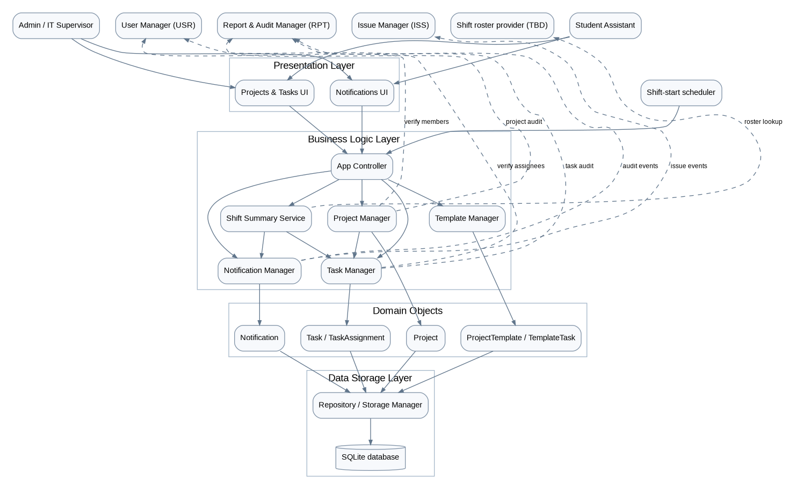

# SP4 System Design — Projects & Tasks (PRJ) and Notifications (NTF)

**Course:** CS487 — IT Inventory Tracker  
**Owner:** Luke Gregory Pamaos  
**Source:** SP2 Requirements Collection, SP3 User Stories, professor feedback.  
**Sub-issue:** #29 (parent #27). **Status:** Proposed SP4 design; pending team decisions indicated below. Only PRJ/NTF internals are designed. Names of shared managers are interface labels, subject to the parent issue's naming conventions.

## 3–4. Architecture and component design

The diagram follows **actors → UI → App Controller → managers/services → domain objects → Repository / Storage Manager → SQLite database** and explicitly names the four required groups: Presentation Layer, Business Logic Layer, Domain Objects, and Data Storage Layer. Solid arrows show internal calls/dependencies; dashed arrows show integration with another page's manager or an unresolved roster provider. The two human actors are **Admin (IT Supervisor)** and **Student Assistant**, with equal PRJ/NTF access (SP2 A-01, NFR-PRJ-02). The system scheduler is a non-human trigger for shift notifications. The diagram does not define other members' internals.

### Component responsibilities

| Component | Responsibility |
|---|---|
| Projects & Tasks UI | Collect project, template and task operations; display work and progress. |
| Notifications UI | Show only the logged-in recipient's notifications and read state. |
| App Controller | Authenticate/rout requests to page managers and return results. |
| Project Manager | Create/update projects, manage membership integration and derive project completion. |
| Template Manager | Maintain reusable project templates and request independent copies of their task definitions. |
| Task Manager | Create, link, assign, hand off, search and update tasks; preserve assignment history. |
| Notification Manager (Notification Manager) | Route one notification per recipient/event, store it, and manage read state. |
| Shift Summary Service | On shift-start trigger, obtain roster and scheduled work and create per-person summaries. |
| Repository / Storage Manager | Save/retrieve PRJ and NTF domain records using SQLite without UI-to-storage coupling. |
| User / Authentication Manager (external) | Supply logged-in identity and eligible Admin/SA accounts; owned by USR. |
| Issue Manager (external) | Publish issue-created events; owned by ISS. |
| Report / Audit Manager (external) | Record immutable change history; owned by RPT/shared audit service. |
| Shift roster provider (external/TBD) | Supply current roster and shift timing; ownership/source not yet approved. |

**Conceptual domain objects:** `Project`, `ProjectTemplate`, `TemplateTask`, `Task`, `TaskAssignment`, `Notification`; shared `User`, `AuditRecord` are referenced but not designed here. SP4 intentionally excludes class attributes/methods, database tables, state diagrams and sequence diagrams.

## 9. Numbered workflows

### WF-PRJ-01 — Create a project from a template (UC-PRJ-01; US-PRJ-02)

1. Logged-in Admin or SA opens **Projects & Tasks → Create Project → From Template**.
2. UI requests available `ProjectTemplate` definitions through App Controller and Template Manager.
3. User selects an existing template and enters project name, description, start date, optional due date and project status (status vocabulary **Confirm**).
4. UI checks missing values/date format; App Controller checks session and calls Project Manager and Template Manager.
5. Template Manager verifies the template exists; Project Manager applies project validation and BR-13.
6. Managers create a **new** `Project` with a unique project ID and **new** `Task` records copied from `TemplateTask` definitions. Copies are independent of the original template; status and assignees follow approved policy.
7. Repository commits project and copied tasks together; if save fails, no partial project is presented as created. The change is sent to shared audit logging (BR-03).
8. If project members are known, Project Manager emits a saved-project event; Notification Manager creates in-app notifications **only for members** (FR-NTF-06). A notification failure does not undo the saved project (proposed resilience rule; confirm).
9. UI shows the new project ID and copied tasks or a specific failure message; edits to copies never alter the template.

### WF-NTF-01 — Send a shift work summary (UC-NTF-01; US-NTF-03)

1. At the **beginning of a configured shift**, the system scheduler triggers App Controller → Shift Summary Service; this is not a manual Send button in SP2/SP3.
2. Shift Summary Service requests the **current shift roster** from the designated provider (source, exact time and supported shifts **Confirm**).
3. For each rostered Admin/SA, service requests work scheduled for that shift from Task Manager. Treatment of overdue/unassigned tasks is **Confirm**.
4. Service assembles a shift-specific work list for that recipient.
5. Notification Manager creates **one in-app notification per recipient and triggering shift event** (BR-16), including shift and creation time.
6. Repository stores notifications; shared audit records the system event and timestamp. Staff outside the roster receive no shift notification.
7. Staff open Notifications UI and see their own shift summary, with read/unread state; a failed creation is logged for follow-up and must not be represented as delivered.
8. Email is **not invoked in the baseline** pending resolution of the SP2 email-scope contradiction.

### WF-PRJ-02 — Assign, hand off and update task (UC-PRJ-02/03)

1. Logged-in Admin or SA selects an existing task or creates one (standalone or linked to one project).
2. UI submits selected eligible assignee(s), or new status from `To Do`, `In Progress`, `Complete`.
3. Task Manager validates task, assignees and status; a handoff requires an unfinished task.
4. Repository saves assignment history and the unchanged task status on handoff, or saves the requested status change; shared audit captures old/new values.
5. For new assignees, Notification Manager creates one notification per recipient; task assignment remains saved even if notification fails (US-NTF-01).
6. Project Manager refreshes project progress; a project is complete only when **all** its tasks are `Complete` (BR-15).
7. UI shows updated task, assignees, history and progress or the applicable error.

## 12. User interface

| Screen / menu operation | Input → validation → manager → displayed result |
|---|---|
| Projects → List/Search | Text, status, assignee, due date → validate filter inputs → Project/Task Manager → matching records or `No matching projects or tasks found.` (Should Have, US-PRJ-06). |
| Projects → New Project | Name, description, start date, optional due date, status → required/date/status checks → Project Manager → new project ID or error. |
| Projects → Templates | Template task definitions → validate required task definitions → Template Manager → saved template or error. |
| Projects → Create From Template | Template selection and project details → template existence and project checks → Template/Project/Task Managers → independent project/task copies or error. |
| Projects → Project Detail | Project ID → check exists → Project Manager → project, members (where defined), tasks and progress. |
| Tasks → New/Edit/Link | Title, description, status, optional due date, optional project → validate values/project existence → Task Manager → saved standalone or linked task. |
| Tasks → Assign/Reassign | Task and one or more eligible staff → validate accounts → Task Manager → updated assignees, history and notification event. |
| Tasks → Hand Off | Unfinished task, receiving staff → validate unfinished task/account → Task Manager → retained status and assignment history. |
| Tasks → Update Progress | Task and status → validate allowed values → Task Manager → saved status and refreshed project progress. |
| Notifications → My Notifications | Logged-in recipient → verify identity → Notification Manager → own notifications with event, time, related item and read state. |
| Notifications → Mark Read/Unread | Notification ID and desired read state → verify ownership → Notification Manager → updated state (Should Have). |
| Notifications → Shift Summary | System-triggered on shift start; user views generated notification → Notification Manager → shift work and time, or no notification if not rostered. |

No delete, mark-all-read or linked-item navigation is assumed (FR-NTF-05 marked Confirm). No manually initiated shift-summary send is asserted.

## 11. Validation and error handling

The following **exact display strings are proposed SP4 UI messages**, not quotations from SP2/SP3. Rules and outcomes are grounded in the referenced requirements. Invalid input causes **no record change** unless otherwise stated.

| Condition / source | Proposed exact message | System response |
|---|---|---|
| Unauthenticated user (BR-04) | `Please log in to continue.` | Block operation. |
| Missing project name (FR-PRJ-01) | `Project name is required.` | Do not create. |
| Missing project description (FR-PRJ-01) | `Project description is required.` | Do not create. |
| Missing start date (FR-PRJ-01) | `Start date is required.` | Do not create. |
| Invalid date or due date before start (design proposal) | `Enter a valid due date on or after the start date.` | Do not create; confirm date ordering rule. |
| Missing/unknown template (FR-PRJ-02, BR-13) | `Select an existing project template.` | No project/tasks created. |
| Template copy/save fails (BR-13) | `Project could not be created. No changes were saved.` | Roll back partial copy. |
| Missing task title (FR-PRJ-03) | `Task title is required.` | Do not create. |
| Missing task description (FR-PRJ-03) | `Task description is required.` | Do not create. |
| Invalid task status (BR-15) | `Choose To Do, In Progress, or Complete.` | Do not change status. |
| Unknown project link (BR-14) | `Selected project was not found.` | Do not link task. |
| Invalid assignee (BR-14) | `Select an existing Admin or Student Assistant.` | Do not assign. |
| Handoff of completed task (FR-PRJ-07) | `Only unfinished tasks can be handed off.` | Do not hand off. |
| Unknown task/project ID (BR-01) | `Requested project or task was not found.` | Do not modify. |
| Notification not owned by user (US-NTF-04/05) | `Notification not found or access denied.` | Do not reveal or modify another recipient's record. |
| Unknown recipient/event (BR-16) | `Notification recipient or triggering event is invalid.` | Do not create invalid notification. |
| Missing roster/shift configuration (FR-NTF-03) | `Shift summary unavailable: shift roster is not configured.` | Log failure; do not send to guessed recipients. |
| Notification persistence fails (US-NTF-01) | `Notification could not be saved.` | Preserve already saved assignment/issue; log failure. |
| Email delivery fails (conditional FR-NTF-07) | `Email delivery failed; in-app notification is still available.` | Only relevant if email is approved in scope. |

**Other rules:** BR-01 unique IDs; BR-02 no hard deletion; BR-03 audit user/time/old/new values; BR-13 independent template copies; BR-14 task assigned to one or more Admin/SAs and assignment history retained; BR-15 task statuses and completion; BR-16 one recipient/trigger per notification. Project status vocabulary, project membership source, shift roster/times and issue notification routing remain unconfirmed. Never invent a fixed issue recipient (US-NTF-02).

## 14. Traceability — SP3 stories to use cases and components

| SP3 story | Story title | SP2 use case | Primary SP4 component |
|---|---|---|---|
| US-PRJ-01 | Create a Project | UC-PRJ-02 | Project Manager |
| US-PRJ-02 | Create a Project from a Template | UC-PRJ-01 | Template Manager; Project Manager; Task Manager |
| US-PRJ-03 | Create a Task | UC-PRJ-02 | Task Manager |
| US-PRJ-04 | Assign or Reassign a Task | UC-PRJ-02 | Task Manager; Notification Manager |
| US-PRJ-05 | Update Task Progress | UC-PRJ-03 | Task Manager; Project Manager |
| US-PRJ-06 | Search and Filter Work | UC-PRJ-02 | Project Manager; Task Manager |
| US-PRJ-07 | Hand Off an Unfinished Task | UC-PRJ-02 | Task Manager |
| US-NTF-01 | Notify Staff About New Work and Issues | UC-NTF-01 | Notification Manager |
| US-NTF-02 | Route Notifications to the Right Recipients | UC-NTF-01 | Notification Manager |
| US-NTF-03 | Receive a Shift Summary | UC-NTF-01 | Shift Summary Service; Notification Manager |
| US-NTF-04 | View My Notifications | UC-NTF-02 | Notification Manager |
| US-NTF-05 | Mark a Notification Read or Unread | UC-NTF-02 | Notification Manager |
| US-NTF-06 | Notify Project Members | UC-NTF-01 | Project Manager; Notification Manager |
| US-NTF-07 | Receive Email Copies of Notifications | UC-NTF-01 | Notification Manager; email adapter (conditional, out of scope in SP2 §13) |

**Note:** `US-PRJ-01` is associated with `UC-PRJ-02` in SP3 despite that use case's task-focused title. This table preserves SP3's mapping rather than inventing a new use case. `US-NTF-07` remains traceable but its implementation is conditional on resolving the scope conflict.

## 16. Definition-of-complete checklist, scope and open decisions

- **Coverage:** all 7 PRJ and all 7 NTF SP3 stories appear in Section 12; key project-template and shift-summary flows are numbered; interfaces and failure outcomes are specified.
- **Separation of concerns:** PRJ/NTF UI does not access SQLite directly; other team members' managers are only referenced via dashed integration calls. The RPT owner owns audit history display and shared logging implementation; USR owns identity; ISS owns issue creation.
- **Conflict to resolve — email:** FR-NTF-07, BR-16 and US-NTF-07 require email, while SP2 Section 13 excludes email/SMS. **Baseline proposed for SP4: in-app only**; email adapter is a future/conditional integration until team/instructor approves a revised scope. Do not mark US-NTF-07 implemented under this baseline.
- **Confirm — shifts:** roster source, supported shifts, trigger times and overdue/unassigned work handling (Q-NTF-01/02, FR-NTF-03).
- **Confirm — recipients:** issue and repeat-issue routing (Q-NTF-03, FR-NTF-02); do not default to all Admins without a decision.
- **Confirm — PRJ:** project status values; template default assignees/priorities/relative due dates; assignee count is stated as one or more in BR-14 but FR-PRJ-04 still flags it for confirmation; required search filters are Should Have.
- **Confirm — membership:** project notifications are member-only (FR-NTF-06), but the exact membership-maintenance mechanism needs team agreement.
- **Testability:** verify independent template copies, unique IDs, all-or-nothing project creation, handoff history, status completion, recipient privacy, shift roster exclusion, audit logging, and non-destructive notification failures. These are verifiable outcomes, not requirement titles.
- **Out of scope for this document:** SP5 class methods/attributes, SP6 schema, SP7 state diagrams, SP8 sequence diagrams; other owners' page internals.

**Review status:** Ready for teammate review; Tom is responsible for the merged system overview and final Canvas submission.

**References:** SP2 Sections 5–9, 11, 13–14; SP3 Epic 7 and Epic 8, Sections 5–7; instructor SP2/SP3 feedback. The Canvas SP4 guide and GitHub parent-issue naming rules were not supplied; verify their exact conventions before PR merge.
