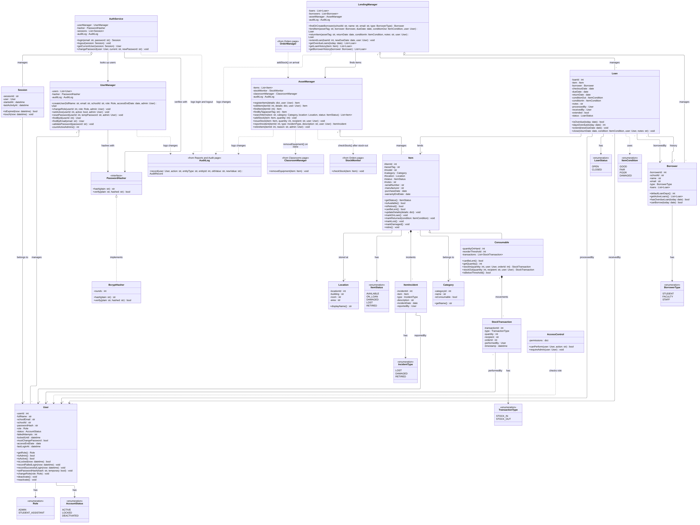

# SP5 – Object Design (UML): Assets & Lending and Login & Users

**Designer:** Zafar Azatov · **Issue:** #40 (parent #39)

**Sources:** merged SP2 requirements (§11 classes, §8 business rules), SP3 user stories (US-AST-01 – 11, US-USR-01 – 06), and SP4 design (`AST-USR-system-design.md`). Shared class names follow #39 exactly: `User`, `Role`, `Item`, `Consumable`, `AssetManager`, `Location`.

**Out of scope:** database tables (SP6), state diagrams (SP7), sequence diagrams (SP8).

## 13. Class Diagram

Source: [`AST-USR-classes.mmd`](AST-USR-classes.mmd). Classes owned by other pages are drawn as empty `«from … page»` boxes showing only the method this page calls.

## 5. Domain Classes

### 5.1 Login & Users (USR)

| Class | Kind | Responsibility | Source |
|---|---|---|---|
| `User` | Domain | Staff account: name, school email and ID, role, status. Tracks failed logins and lockout, temporary passwords, access end date. | FR-USR-01, 03, 04, 07, BR-04 |
| `Role` | Enumeration | ADMIN, STUDENT_ASSISTANT. Shared by every page. | FR-USR-05, A-01 |
| `AccountStatus` | Enumeration | ACTIVE, LOCKED, DEACTIVATED. | FR-USR-04, 07 |
| `Session` | Domain | One logged-in session with a 30-minute idle timeout. | FR-USR-02, NFR-USR-02 |
| `PasswordHasher` | Interface | Hash and verify passwords. | NFR-USR-01 |
| `BcryptHasher` | Class | bcrypt implementation of `PasswordHasher`. | NFR-USR-01 |
| `AuthService` | Service | Log in and out, lockout after 5 failures, change own password, give other pages the current user. | US-USR-01, 02 |
| `UserManager` | Manager | Create accounts, change role or status, reset passwords, enforce the password rule and "at least one active Admin". | US-USR-03 – 05, BR-05, BR-06 |
| `AccessControl` | Service | Check whether the user's role allows an action; block Admin-only actions for SAs. | US-USR-06, FR-USR-05 |

### 5.2 Assets & Lending (AST)

| Class | Kind | Responsibility | Source |
|---|---|---|---|
| `Location` | Domain | Building, room, and area (closet, rack, desk). Shared with Classrooms. | FR-AST-01, A-05 |
| `Category` | Domain | Item type (Desktop, Monitor, Cable…) and whether it is consumable. | FR-AST-01 |
| `Item` | Domain (base class) | Inventory record with a unique asset tag, model, category, location and status; changes status when lent, returned, reported, or retired. | FR-AST-01 – 03, 10, 11, BR-01, BR-07 |
| `Consumable` | Domain (subclass of `Item`) | Supply tracked by quantity with a reorder threshold; issued, never lent. | FR-AST-05, 13, 14, BR-11 |
| `StockTransaction` | Domain | One stock-in or stock-out: quantity, recipient, user, time, and the order ID when restocked. | FR-AST-05, FR-AST-13 |
| `Borrower` | Domain | Person who borrows (no login). Knows loan length and eligibility. | FR-AST-06, BR-08, BR-09 |
| `Loan` | Domain | One checkout and return: dates, conditions, staff involved, one-time extension, overdue detection. | FR-AST-06 – 09, 12 |
| `ItemIncident` | Domain | Lost, damaged, or retired event with description and reporter. | FR-AST-10, 11 |
| `ItemStatus` | Enumeration | AVAILABLE, ON_LOAN, DAMAGED, LOST, RETIRED. | SP2 §11 |
| `ItemCondition` | Enumeration | GOOD, FAIR, POOR, DAMAGED (condition out / in). | FR-AST-06, 07, BR-10 |
| `BorrowerType` | Enumeration | STUDENT, FACULTY, STAFF. | BR-08 |
| `LoanStatus` | Enumeration | OPEN, CLOSED. Overdue is derived by `Loan.isOverdue()`. | FR-AST-08 |
| `IncidentType` | Enumeration | LOST, DAMAGED, RETIRED. | FR-AST-10, 11 |
| `TransactionType` | Enumeration | STOCK_IN, STOCK_OUT. | FR-AST-05 |
| `AssetManager` | Manager | Register, edit, search, retire items; record incidents; add and issue stock. Called by Orders and Classrooms. | US-AST-01 – 04, 10, 11 |
| `LendingManager` | Manager | Lend, return, extend loans; list overdue loans and loan history. | US-AST-05 – 09 |

### 5.3 Where each business rule lives

| Rule | Owner method |
|---|---|
| Asset tags unique, never reused (BR-01) | `AssetManager.registerItem()` / `editItem()` |
| Only Available items can be lent; consumables never (BR-07, BR-11) | `Item.canBeLent()`, overridden by `Consumable.canBeLent()` |
| Returned damaged → Damaged (BR-10) | `Item.markReturned(condition)` |
| Loan length 7 / 30 days (BR-08) | `Borrower.defaultLoanDays()` |
| One extension of at most 7 days (BR-08) | `Loan.extend(newDueDate)` |
| Students hold at most 2 items; no loan while overdue (BR-09) | `Borrower.canBorrow(today)` |
| Quantity never below zero (BR-11) | `Consumable.stockOut()` |
| Low-stock check after stock-out (FR-AST-14) | `AssetManager.issueStock()` → `StockMonitor.checkStock()` |
| Received orders increase stock (FR-AST-13) | `AssetManager.addStock(item, quantity)` → `Consumable.stockIn()` |
| Retired items read-only, removed from classroom (BR-07, BR-18) | `Item.retire()`, `AssetManager.retireItem()` → `ClassroomManager.removeEquipment()` |
| Lock for 15 min after 5 failures (FR-USR-07) | `User.recordFailedLogin(now)` |
| Password ≥ 10 chars with letters and digits (BR-06) | `UserManager.validatePassword()` |
| At least one active Admin (BR-05) | `UserManager.countActiveAdmins()` |
| Every change logged with user and time (FR-USR-06, BR-03) | managers call `AuditLog.record()` |

## 6. Class Relationships

| Relationship | Type | Multiplicity | Meaning |
|---|---|---|---|
| `Consumable` → `Item` | Inheritance | — | A consumable is an item tracked by quantity |
| `Item` → `Category`, `Item` → `Location` | Association | * – 1 | Every item has one category and one location |
| `Item` ◆— `ItemIncident` | Composition | 1 – * | Incidents exist only for their item |
| `Consumable` ◆— `StockTransaction` | Composition | 1 – * | Every stock movement belongs to one consumable |
| `Loan` → `Item` | Association | * – 1 | An item has many loans over time, at most one open |
| `Loan` → `Borrower`; `Borrower` ◇— `Loan` | Association / aggregation | * – 1 | A borrower keeps a loan history |
| `Loan` → `User` | Association | * – 1 (processedBy), * – 0..1 (receivedBy) | Staff who lent and received the item |
| `Session` → `User` | Association | * – 1 | A user can have many sessions over time |
| `AuthService` ◇— `Session`, `UserManager` ◇— `User` | Aggregation | 1 – * | Managers hold the objects they manage |
| `AssetManager` ◇— `Item`, `LendingManager` ◇— `Loan` / `Borrower` | Aggregation | 1 – * | Same as above |
| `BcryptHasher` ⇢ `PasswordHasher` | Realization | — | Implements the interface |
| `LendingManager` → `AssetManager` | Association | — | Looks up items and changes their status |

### 6.1 Links to other members' pages

| From | To | Call | Why |
|---|---|---|---|
| `OrderManager` (Orders) | `AssetManager` | `addStock(item, quantity)` | Add received quantity when an order arrives (FR-ORD-03, FR-AST-13) |
| `AssetManager` | `StockMonitor` (Orders) | `checkStock(item)` | After a stock-out, flag items below threshold (FR-AST-14) |
| `AssetManager` | `ClassroomManager` (Classrooms) | `removeEquipment(item)` | A retired item is removed from its room (BR-18) |
| `AssetManager`, `LendingManager`, `UserManager`, `AuthService` | `AuditLog` (Reports & Audit) | `record(...)` | Audit every change (FR-USR-06, BR-03) |
| All pages | `User`, `Role`, `AccessControl` | — | Current user and role checks (BR-04) |

`Order.item : Item` on the Orders page works with consumables because `Consumable` is a subclass of `Item`.

## 7. Object-Oriented Principles

| Principle | Where it appears |
|---|---|
| **Encapsulation** | All attributes are private (`-`) or protected (`#`). `Item` status changes only through `markOnLoan()`, `markReturned()`, `markLost()`, `markDamaged()`, `retire()`. `Consumable` quantity changes only through `stockIn()` / `stockOut()`, which block negative stock. The password hash is never exposed; it is set through `setPasswordHash()` and checked through `PasswordHasher.verify()`. |
| **Abstraction** | `PasswordHasher` is an interface, so `AuthService` and `UserManager` do not depend on bcrypt. Managers expose simple operations such as `lendItem()` and `addStock()` and hide the rule checks behind them. |
| **Inheritance** | `Consumable` extends `Item` and reuses its tag, model, category, location, status, and notes. Shared fields are `#` protected so the subclass can use them. |
| **Polymorphism** | `canBeLent()` is overridden: `Item` returns true only when Available; `Consumable` always returns false (BR-11). `LendingManager` calls `item.canBeLent()` without checking the concrete type. `PasswordHasher.hash()` / `verify()` run whichever implementation is plugged in. |

## Design patterns

| Pattern | Classes | Purpose |
|---|---|---|
| **Strategy** | `PasswordHasher` (interface), `BcryptHasher` | Swap the hashing algorithm (e.g. Argon2) without changing `AuthService` or `UserManager` (NFR-USR-01). |
| **Observer (subject side)** | `AssetManager` → `StockMonitor` (Orders) | Each stock-out triggers `checkStock()`; Orders' observers react to low stock. |
| **Controller** | `AssetManager`, `LendingManager`, `UserManager`, `AuthService` | Each handles its use cases and delegates to domain objects. |
| **Information Expert** | `Borrower.canBorrow()`, `Loan.isOverdue()`, `Consumable.isBelowThreshold()` | Each rule sits in the class that has the data. |

## Relationship notation

| Symbol | Meaning | Example |
|---|---|---|
| Solid arrow | Association | `Loan` → `Item` |
| Hollow diamond | Aggregation | `AssetManager` ◇— `Item` |
| Filled diamond | Composition | `Item` ◆— `ItemIncident` |
| Hollow triangle | Inheritance | `Consumable` → `Item` |
| Dashed hollow triangle | Implements an interface | `BcryptHasher` ⇢ `PasswordHasher` |
| Dashed arrow | Dependency (uses) | `AssetManager` ⇢ `StockMonitor` |

## Open items for the team

1. **Orders:** Tom's `StockMonitor.checkStock(item: Item)` and `Order.item : Item` work as-is. The Orders page could narrow the type to `Consumable`, since only consumables are reordered (FR-ORD-01).
2. **Classrooms:** `ClassroomManager.removeEquipment(item)` is the name assumed here; Nusratilloh's SP5 (#42) should use the same method, or this box will be renamed to match.
