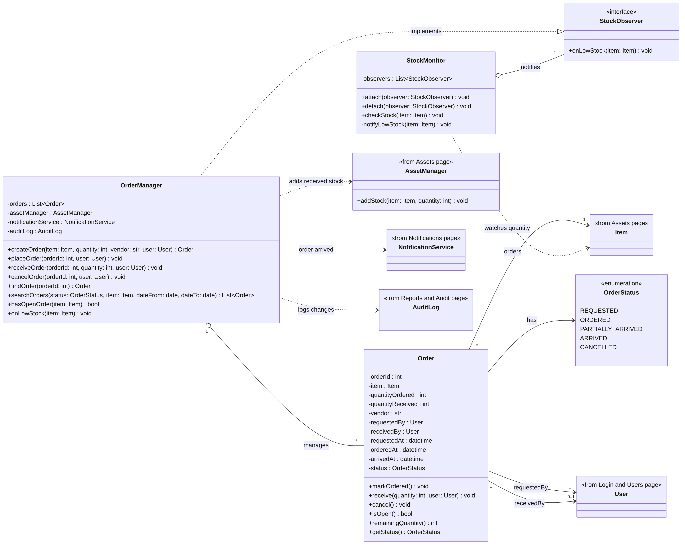
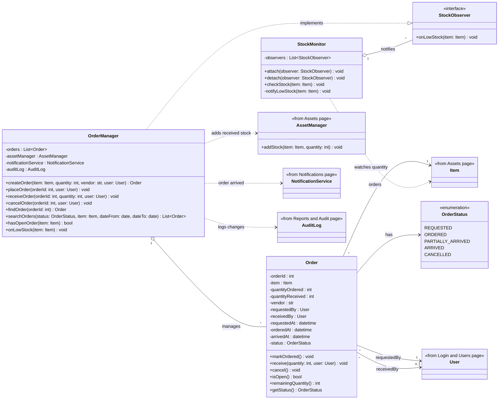
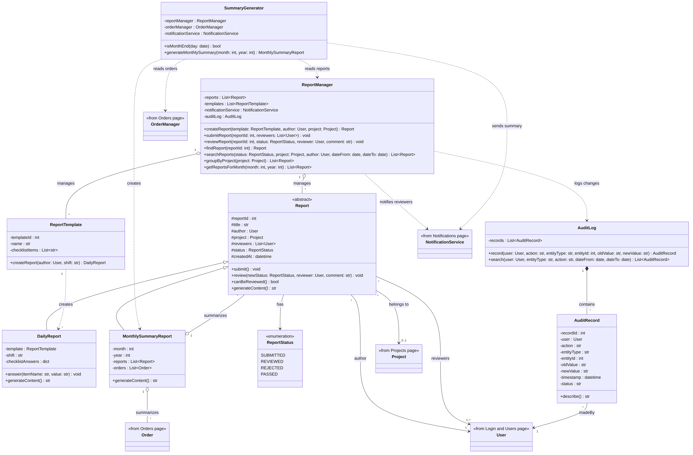
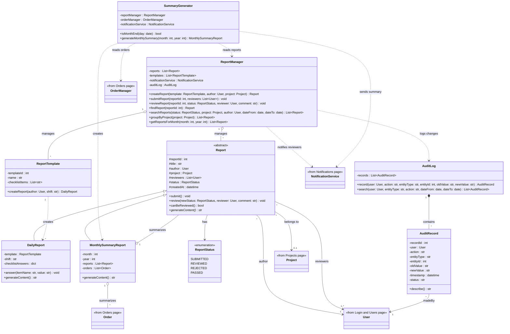

# SP5 – Object Design (UML): Orders and Reports & Audit

**Designer:** Duong Anh Nguyen (Tom)

## Orders (ORD)

## Reports & Audit (RPT)

## Object-oriented principles

| Principle | Where it appears |
|---|---|
| **Encapsulation** | All attributes are private (`-`). An `Order` changes status only through `markOrdered()`, `receive()`, and `cancel()`, which enforce the allowed transitions. Audit records can only be added through `AuditLog.record()`; there is no delete method. |
| **Abstraction** | `Report` is abstract, and `StockObserver` is an interface. Managers expose simple operations such as `receiveOrder()` and hide the steps behind them. |
| **Inheritance** | `DailyReport` and `MonthlySummaryReport` extend `Report` and reuse its ID, author, status, and review logic. |
| **Polymorphism** | Each report subclass implements `generateContent()` differently. `StockMonitor` calls `onLowStock()` on any `StockObserver` without knowing its concrete class. |

## Design patterns

| Pattern | Classes | Purpose |
|---|---|---|
| **Observer** | `StockMonitor` (subject), `StockObserver` (interface), `OrderManager` (observer) | When stock falls below the threshold, every registered observer is told. Other observers, such as the Notification Service, can be added without changing `StockMonitor`. |
| **Factory method** | `ReportTemplate.createReport()` | Creates a `DailyReport` already filled with the template's checklist. |
| **Controller** | `OrderManager`, `ReportManager` | Each handles the use cases of its page and delegates to domain objects. |

## Relationship notation

| Symbol | Meaning | Example |
|---|---|---|
| Solid arrow | Association | `Order` → `Item` |
| Hollow diamond | Aggregation (parts can exist alone) | `OrderManager` ◇— `Order` |
| Filled diamond | Composition (parts live only inside the whole) | `AuditLog` ◆— `AuditRecord` |
| Hollow triangle | Inheritance | `DailyReport` → `Report` |
| Dashed hollow triangle | Implements an interface | `OrderManager` ⇢ `StockObserver` |
| Dashed arrow | Dependency (uses) | `OrderManager` ⇢ `AssetManager` |

Classes marked «from … page» belong to other team members; only their name, and any method this page calls, is shown here.
