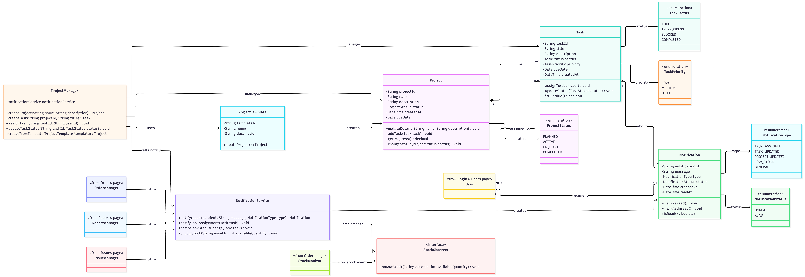

# SP5 — Object Design (UML): Projects & Tasks and Notifications

**System:** IT Inventory Tracker (ITHUB)  
**Assigned pages:** Projects & Tasks (PRJ); Notifications (NTF)  
**Deliverables:** `PRJ-NTF-classes.mmd`, `PRJ-NTF-classes.png`, this write-up  
**Scope:** Class design only. No SP6 database schema, SP7 state diagrams, or SP8 sequence diagrams.

## 1. Purpose and design boundaries

This design specifies the domain objects, services, enumerations, interface, and associations for the PRJ and NTF pages. It follows the professor's class-diagram example by using typed attributes, public operations, visibility markers, and multiplicities. Classes owned by teammates appear **only as labeled external references**, not as redefinitions.

**Source caveat:** The approved text of SP2 FR-PRJ-01–07 and FR-NTF-01–08 and the full SP4 component definitions have not been checked against this revision. Method signatures, enum values, and suggested patterns below are **proposed** and require final comparison with those sources. The issue's explicit naming and integration requirements take precedence over the older draft.

## 2. Domain classes and operations

UML notation: `-` private attribute; `+` public operation. Types are included for each attribute and operation.

### `Project`

| Private attributes | Public methods |
|---|---|
| `- projectId: String` | `+ updateDetails(name: String, description: String): void` |
| `- name: String` | `+ addTask(task: Task): void` |
| `- description: String` | `+ getProgress(): decimal` |
| `- status: ProjectStatus` | `+ changeStatus(status: ProjectStatus): void` |
| `- createdAt: DateTime` | |
| `- dueDate: Date` | |

### `Task`

| Private attributes | Public methods |
|---|---|
| `- taskId: String` | `+ assignTo(user: User): void` |
| `- title: String` | `+ updateStatus(status: TaskStatus): void` |
| `- description: String` | `+ isOverdue(): boolean` |
| `- status: TaskStatus` | |
| `- priority: TaskPriority` | |
| `- dueDate: Date` | |
| `- createdAt: DateTime` | |

### `Notification`

| Private attributes | Public methods |
|---|---|
| `- notificationId: String` | `+ markAsRead(): void` |
| `- message: String` | `+ markAsUnread(): void` |
| `- type: NotificationType` | `+ isRead(): boolean` |
| `- status: NotificationStatus` | |
| `- createdAt: DateTime` | |
| `- readAt: DateTime` | |

## 3. Managers, services, factory, and interface

### `ProjectManager` (PRJ)

- Private dependency: `- notificationService: NotificationService`
- `+ createProject(name: String, description: String): Project`
- `+ createTask(projectId: String, title: String): Task`
- `+ assignTask(taskId: String, userId: String): void`
- `+ updateTaskStatus(taskId: String, status: TaskStatus): void`
- `+ createFromTemplate(template: ProjectTemplate): Project`

### `ProjectTemplate` (PRJ; proposed factory)

- `- templateId: String`
- `- name: String`
- `- description: String`
- `+ createProject(): Project`

The template encapsulates predefined project settings and creates a new `Project`. This is a **simple factory-style creation method**, not a claim that the formal Factory Method pattern has been fully implemented.

### `NotificationService` (NTF)

- `+ notify(recipient: User, message: String, type: NotificationType): Notification`
- `+ notifyTaskAssignment(task: Task): void`
- `+ notifyTaskStatusChange(task: Task): void`
- `+ onLowStock(assetId: String, availableQuantity: int): void`

`notify(...)` is the shared entry point called by Projects, Orders, Reports, and Issues. The task-specific methods are convenience methods that can delegate to `notify(...)`.

### `StockObserver` (NTF / Orders integration interface)

- `+ onLowStock(assetId: String, availableQuantity: int): void`

`NotificationService` **implements** `StockObserver`. The Orders-side `StockMonitor` can notify observers when low-stock events occur. The precise callback signature must be coordinated with the Orders owner; the above signature is a proposed interface contract.

## 4. Enumerations

| Enum | Proposed values |
|---|---|
| `ProjectStatus` | `PLANNED`, `ACTIVE`, `ON_HOLD`, `COMPLETED` |
| `TaskStatus` | `TODO`, `IN_PROGRESS`, `BLOCKED`, `COMPLETED` |
| `TaskPriority` | `LOW`, `MEDIUM`, `HIGH` |
| `NotificationType` | `TASK_ASSIGNED`, `TASK_UPDATED`, `PROJECT_UPDATED`, `LOW_STOCK`, `GENERAL` |
| `NotificationStatus` | `UNREAD`, `READ` |

These values are design proposals pending validation against SP2/SP3 and team conventions.

## 5. UML class diagram and relationships

The editable Mermaid source is in [`PRJ-NTF-classes.mmd`](PRJ-NTF-classes.mmd). The companion image is [`PRJ-NTF-classes.png`](PRJ-NTF-classes.png).

| Relationship | UML multiplicity / kind | Meaning |
|---|---|---|
| `Project` — `Task` | `Project 1` to `Task 0..*`; composition | A project contains zero or more tasks; each task belongs to one project. |
| `User` — `Task` | `User 0..1` to `Task 0..*`; association | A task has at most one assignee; a user can have many assigned tasks. |
| `User` — `Notification` | `User 1` to `Notification 0..*`; association | Each notification has one recipient; a user can receive many. |
| `Task` — `Notification` | `Task 0..1` to `Notification 0..*`; association | A notification can optionally refer to a task. |
| `ProjectManager` → `Project`, `Task` | dependency | Coordinates project and task operations. |
| `ProjectManager` → `NotificationService` | dependency | Requests notifications after project/task changes. |
| `ProjectTemplate` → `Project` | creation dependency | Creates projects from predefined settings. |
| `NotificationService` → `StockObserver` | interface realization | Implements low-stock callback. |
| `NotificationService` → `Notification` | creation dependency | Creates notifications. |
| `OrderManager`, `ReportManager`, `IssueManager` → `NotificationService` | dependencies | External modules call `notify(...)`. |
| `StockMonitor` → `StockObserver` | dependency | Orders module emits low-stock events. |
| Classes → their enums | type dependency | Attribute types, not ownership. |

### External class references (not owned by this submission)

- `User` — `<<from Login & Users page>>`
- `OrderManager` — `<<from Orders page>>`
- `StockMonitor` — `<<from Orders page>>`
- `ReportManager` — `<<from Reports page>>`
- `IssueManager` — `<<from Issues page>>`

External classes are intentionally **empty reference boxes** in the diagram. Confirm the exact names of `ReportManager` and other external interfaces with the team before merging.

## 6. OOP principles

| Principle | Where it appears | Explanation |
|---|---|---|
| **Encapsulation** | `Project`, `Task`, `Notification` | Attributes are private (`-`); updates occur through public (`+`) methods. |
| **Abstraction** | `StockObserver` | Defines the low-stock notification contract without prescribing how notifications are created or delivered. |
| **Inheritance / interface realization** | `NotificationService ..|> StockObserver` | The service implements the observer interface. This is interface realization, **not class inheritance**; no class inheritance hierarchy is introduced without an actual need. |
| **Polymorphism** | `StockObserver` implementations | A stock monitor can call `onLowStock(...)` through the interface, regardless of the concrete observer implementation. The diagram shows one concrete implementation (`NotificationService`); additional implementations are possible but not claimed. |

## 7. Design patterns

| Pattern | Classes | Use / qualification |
|---|---|---|
| **Observer** (proposed integration) | `StockObserver`, `StockMonitor` (external), `NotificationService` | `StockMonitor` sends low-stock events to `StockObserver`; `NotificationService` implements the callback. Registration/unregistration mechanics are owned by the Orders page and are not specified here. |
| **Simple Factory** (proposed) | `ProjectTemplate`, `Project`, `ProjectManager` | `ProjectTemplate.createProject()` constructs a project with template settings; `ProjectManager.createFromTemplate(...)` delegates creation. This is factory-style creation, not necessarily GoF Factory Method. |

## 8. Consistency and submission checklist

- [x] PRJ and NTF classes, managers, enums, and interface included.
- [x] Attributes and methods use visibility and types.
- [x] Multiplicity on the domain associations.
- [x] External dependencies labeled `<<from … page>>` without modeling teammate internals.
- [x] OOP principles and proposed patterns documented.
- [x] Source Mermaid file and companion PNG included.
- [ ] Confirm method signatures and enum values against approved SP2/SP3/SP4.
- [ ] Confirm external names and observer callback with owners / parent issue #39.
- [ ] Obtain team review and open PR with `Closes #<your actual sub-issue number>`.

**Scope note:** No database tables, state diagrams, or sequence diagrams are included.
