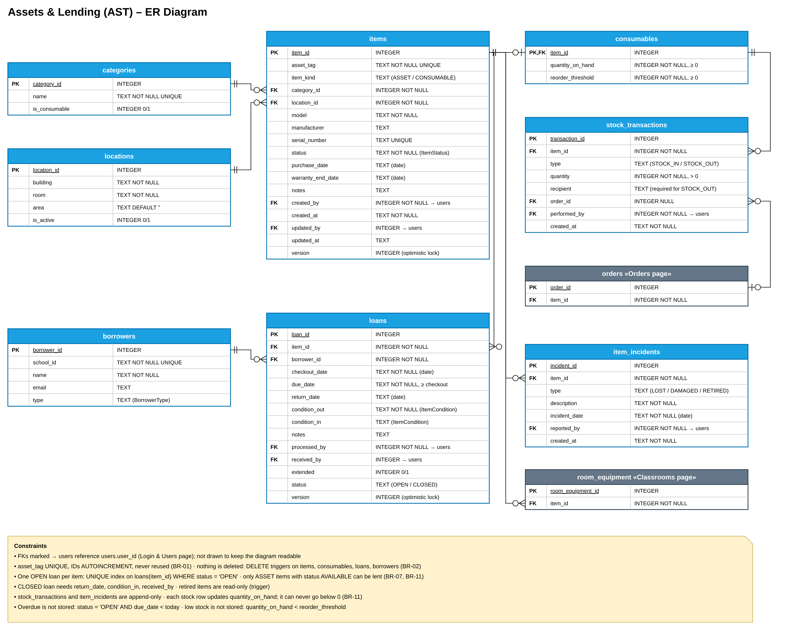
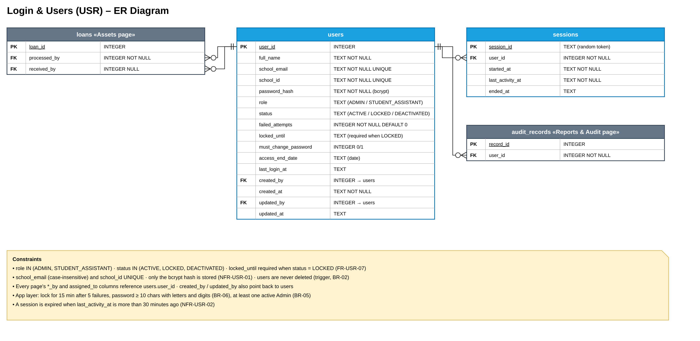

# SP6 – Database Design (ER): Assets & Lending and Login & Users

**Designer:** Zafar Azatov
**Files:** `AST-USR-er.drawio` (2 pages), `AST-er.png`, `USR-er.png`, `AST-USR-schema.sql`
**Database:** SQLite

Blue tables belong to these pages. Grey tables belong to other pages and show only the columns referenced here.

## 1. Assets & Lending (AST)

| Table | Purpose |
|---|---|
| `items` | One row per inventory record (assets and consumables) |
| `consumables` | Quantity and reorder threshold for consumable items |
| `stock_transactions` | Every stock-in and stock-out of a consumable |
| `categories` | Item types (Laptop, Monitor, Cable…) |
| `locations` | Building, room and area where items are kept |
| `borrowers` | People who borrow items (no login) |
| `loans` | One checkout and return of an item |
| `item_incidents` | Lost, damaged and retired events |

| Relationship | Cardinality | Foreign key |
|---|---|---|
| categories → items | 1 category has 0..* items | `items.category_id` |
| locations → items | 1 location has 0..* items | `items.location_id` |
| items → consumables | 1 item has 0..1 consumable row | `consumables.item_id` (PK and FK) |
| consumables → stock_transactions | 1 consumable has 0..* movements | `stock_transactions.item_id` |
| orders → stock_transactions | a stock-in comes from 0..1 order | `stock_transactions.order_id` (Orders page, nullable) |
| items → loans | 1 item has 0..* loans, at most 1 open | `loans.item_id` |
| borrowers → loans | 1 borrower has 0..* loans | `loans.borrower_id` |
| items → item_incidents | 1 item has 0..* incidents | `item_incidents.item_id` |
| items → room_equipment | 1 item is installed in 0..1 room at a time | `room_equipment.item_id` (Classrooms page) |
| users → loans, stock_transactions, item_incidents, items | 1 user records 0..* rows | `processed_by`, `received_by`, `performed_by`, `reported_by`, `created_by`, `updated_by` |

**Rules enforced in the database**
- Asset tags are unique, and IDs use `AUTOINCREMENT`, so they are never reused (BR-01).
- Triggers block `DELETE` on `items`, `consumables`, `loans` and `borrowers` (BR-02). `stock_transactions` and `item_incidents` are append-only.
- One open loan per item: a partial unique index on `loans(item_id) WHERE status = 'OPEN'`.
- Only `ASSET` items with status `AVAILABLE` can be lent (BR-07, BR-11). Retired items are read-only.
- A `CLOSED` loan must have `return_date`, `condition_in` and `received_by`. `due_date ≥ checkout_date`.
- Each `stock_transactions` row updates `quantity_on_hand` through a trigger, and quantity can never go below 0 (BR-11). A stock-out needs a recipient.
- Overdue and low stock are not stored. They are computed as `status = 'OPEN' AND due_date < today` and `quantity_on_hand < reorder_threshold`.

## 2. Login & Users (USR)

| Table | Purpose |
|---|---|
| `users` | Staff accounts (Admin, Student Assistant), shared by every page |
| `sessions` | Logged-in sessions with a 30-minute idle timeout |

| Relationship | Cardinality | Foreign key |
|---|---|---|
| users → sessions | 1 user has 0..* sessions | `sessions.user_id` |
| users → audit_records | 1 user makes 0..* records | `audit_records.user_id` (Reports & Audit page) |
| users → loans | 1 user processes and receives 0..* loans | `loans.processed_by`, `loans.received_by` (nullable) |
| users → every page | all `*_by` and `assigned_to` columns | `users.user_id` |

**Rules enforced in the database**
- `role` is `ADMIN` or `STUDENT_ASSISTANT`. `status` is `ACTIVE`, `LOCKED` or `DEACTIVATED`. `locked_until` is required when the account is `LOCKED` (FR-USR-07).
- `school_email` (case-insensitive) and `school_id` are unique. Only the bcrypt hash is stored (NFR-USR-01).
- Users are never deleted (trigger, BR-02).
- These rules are enforced in the app layer: the lockout after 5 failures, the password rule (BR-06), and keeping at least one active Admin (BR-05).

## Design decisions
- **Inheritance:** `Item` and `Consumable` use class-table inheritance. Shared columns stay in `items`, so `loans`, `orders` and `room_equipment` all point to one `item_id`. `consumables` adds the quantity columns, and `items.item_kind` tells the two kinds apart.
- **Normalization (3NF):** category, location and borrower data live in their own tables. `quantity_on_hand` is the one stored derived value, kept in sync by a trigger so that low-stock checks are fast.
- **Concurrency:** `items` and `loans` have a `version` column for optimistic locking.
- **Dates:** stored as ISO-8601 `TEXT`, the same as Classrooms & Issues SP4 §10.

## Class → table mapping

| Class (SP5) | Table |
|---|---|
| `User`, `Role`, `AccountStatus` | `users` (`role`, `status` columns) |
| `Session` | `sessions` |
| `Item`, `ItemStatus` | `items` |
| `Consumable` | `consumables` |
| `StockTransaction`, `TransactionType` | `stock_transactions` |
| `Category`, `Location` | `categories`, `locations` |
| `Borrower`, `BorrowerType` | `borrowers` |
| `Loan`, `LoanStatus`, `ItemCondition` | `loans` |
| `ItemIncident`, `IncidentType` | `item_incidents` |
| `AuthService`, `UserManager`, `AccessControl`, `PasswordHasher`, `AssetManager`, `LendingManager` | none (services, no stored data) |

## Checked with Orders & Reports (#47)
- `ORD-RPT-schema.sql` and `AST-USR-schema.sql` load together with no foreign-key errors. A full order flow works: create an order, stock-in with `order_id`, write an audit record.
- The shared names match: `users.user_id`, `items.item_id`, `stock_transactions.order_id`.
- **Please confirm:**
  - `orders.item_id` should reference `consumables(item_id)`, since only consumables are reordered (FR-ORD-01).
  - `audit_records` needs `reason` and `triggered_by` columns for BR-03.
