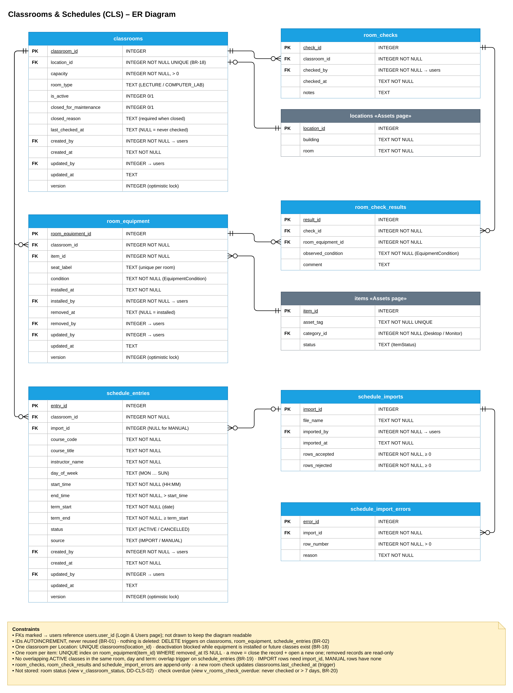
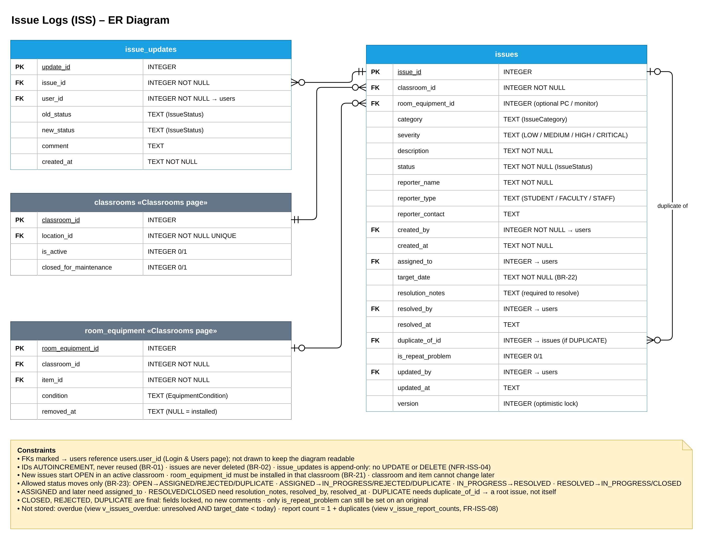

# SP6 – Database Design (ER): Classrooms & Schedules and Issue Logs

**Designer:** Nusratilloh Soliev (@nusratillokh-dev)
**Files:** `CLS-ISS-er.drawio` (2 pages), `CLS-er.png`, `ISS-er.png`, `CLS-ISS-schema.sql`
**Database:** SQLite
**Source:** SP4 `docs/sp4-system-design/CLS-ISS/CLS-ISS-system-design.md` §5, §6 and §10 (data storage), refined here.

Blue tables belong to these pages. Grey tables belong to other pages and show only the columns referenced here.

## 1. Classrooms & Schedules (CLS)

| Table | Purpose |
|---|---|
| `classrooms` | One row per teaching room, linked to one Location |
| `room_equipment` | One installation of a PC or monitor in a room, with its condition. A move closes the row and opens a new one, so the rows are the equipment history |
| `room_checks` | One check of a room by an SA |
| `room_check_results` | The condition seen for each installed item during a check |
| `schedule_entries` | One weekly class meeting (course, room, day, time, term) |
| `schedule_imports` | One registrar CSV upload, with accepted and rejected counts |
| `schedule_import_errors` | One rejected CSV row, with its row number and reason |

| Relationship | Cardinality | Foreign key |
|---|---|---|
| locations → classrooms | 1 location has 0..1 classroom | `classrooms.location_id` (UNIQUE, Assets page) |
| classrooms → room_equipment | 1 classroom has 0..* equipment rows | `room_equipment.classroom_id` |
| items → room_equipment | 1 item has 0..* rows, at most 1 installed | `room_equipment.item_id` (Assets page) |
| classrooms → room_checks | 1 classroom has 0..* checks | `room_checks.classroom_id` |
| room_checks → room_check_results | 1 check has 0..* results (composition) | `room_check_results.check_id` |
| room_equipment → room_check_results | 1 equipment row has 0..* results | `room_check_results.room_equipment_id` |
| classrooms → schedule_entries | 1 classroom has 0..* entries | `schedule_entries.classroom_id` |
| schedule_imports → schedule_entries | an entry comes from 0..1 import | `schedule_entries.import_id` (NULL for manual) |
| schedule_imports → schedule_import_errors | 1 import has 0..* rejected rows | `schedule_import_errors.import_id` |
| users → every CLS table | 1 user records 0..* rows | `created_by`, `updated_by`, `installed_by`, `removed_by`, `checked_by`, `imported_by` |

**Rules enforced in the database**
- IDs use `AUTOINCREMENT`, so they are never reused (BR-01). Triggers block `DELETE` on `classrooms`, `room_equipment` and `schedule_entries` (BR-02). `room_checks`, `room_check_results` and `schedule_import_errors` are append-only.
- One classroom per Location: `UNIQUE (location_id)` (BR-18). `capacity > 0`. A closed room needs a `closed_reason`.
- A classroom cannot be deactivated while it has installed equipment or active classes whose `term_end` is today or later (BR-18).
- One room per item: a partial unique index on `room_equipment(item_id) WHERE removed_at IS NULL`. A seat label is used once per room.
- Only an `ASSET` that is not `RETIRED`, `LOST` or `ON_LOAN` can be installed, and only in an active room. A removed row is read-only, and a row can never change its room or item (a move is remove + new row).
- `removed_at` and `removed_by` are set together. Each room check result must be for equipment in the room being checked.
- A new room check updates `classrooms.last_checked_at` through a trigger.
- Schedule: `end_time > start_time` (HH:MM), `term_end ≥ term_start`, `day_of_week` is `MON`…`SUN`. `IMPORT` rows need `import_id`; `MANUAL` rows have none.
- No overlapping `ACTIVE` classes in the same room, day and term (BR-19): an `INSERT` and `UPDATE` trigger. A `CANCELLED` entry stays as history and cannot change.
- Room status and overdue checks are not stored. They are computed by the views `v_classroom_status` (DD-CLS-02: CLOSED / AVAILABLE / LIMITED / UNUSABLE, counting only Desktop PCs) and `v_rooms_check_overdue` (never checked or older than 7 days, BR-20).

## 2. Issue Logs (ISS)

| Table | Purpose |
|---|---|
| `issues` | One reported problem in a classroom, optionally for one installed PC or monitor |
| `issue_updates` | The history of an issue: one row per status change or comment |

| Relationship | Cardinality | Foreign key |
|---|---|---|
| classrooms → issues | 1 classroom has 0..* issues | `issues.classroom_id` |
| room_equipment → issues | an issue is about 0..1 installed item | `issues.room_equipment_id` (nullable) |
| issues → issue_updates | 1 issue has 0..* history rows (composition) | `issue_updates.issue_id` |
| issues → issues (duplicate of) | a duplicate points to 0..1 original | `issues.duplicate_of_id` (self, nullable) |
| users → issues | 1 user creates, is assigned or resolves 0..* issues | `created_by`, `assigned_to`, `resolved_by`, `updated_by` |
| users → issue_updates | 1 user writes 0..* history rows | `issue_updates.user_id` |

**Rules enforced in the database**
- IDs use `AUTOINCREMENT` (BR-01). Issues are never deleted (BR-02). `issue_updates` has no `UPDATE` or `DELETE` (NFR-ISS-04).
- A new issue starts `OPEN` in an active classroom. Classroom, category, severity, description, reporter name and type are required (BR-21). `target_date ≥ created_at` (BR-22).
- `room_equipment_id`, if given, must be installed in the same classroom. Classroom and item cannot change later.
- Only the allowed status moves (BR-23): `OPEN → ASSIGNED / REJECTED / DUPLICATE`, `ASSIGNED → IN_PROGRESS / REJECTED / DUPLICATE`, `IN_PROGRESS → RESOLVED`, `RESOLVED → IN_PROGRESS / CLOSED`. Any other move fails with "This status change is not allowed."
- From `ASSIGNED` on, `assigned_to` is required. `RESOLVED` and `CLOSED` need `resolution_notes`, `resolved_by` and `resolved_at`; reopening clears them (the old notes stay in `issue_updates`).
- `DUPLICATE` needs `duplicate_of_id`, which cannot be the issue itself or another duplicate, so every chain points to one root.
- `CLOSED`, `REJECTED` and `DUPLICATE` are final: their fields are locked and no comments can be added. Only `is_repeat_problem` can still be set on an original.
- An `issue_updates` row is a comment (text only, not empty), the creation line (`new_status = OPEN`) or a status change (`old_status ≠ new_status`).
- Overdue and the report count are not stored. They are computed by the views `v_issues_overdue` (unresolved and `target_date < today`) and `v_issue_report_counts` (1 + duplicates, FR-ISS-08). `is_repeat_problem` is stored so the notification is sent only once.
- Indexes on `status`, `classroom_id`, `room_equipment_id`, `created_at`, `(assigned_to, status)` and open issues by `target_date` keep the filtered list under 2 s for 5,000 issues (NFR-ISS-02).

## Design decisions
- **Database rules vs. app rules:** the database keeps the data valid even if the app has a bug (keys, allowed values, no deletes, overlaps, status moves). Role checks (Admin-only assign, reject, close), the Desktop/Monitor category check, the target date by severity, and the automatic equipment and room changes of an issue (`IssueEffect` strategies, DD-ISS-01) stay in the business layer, as in SP4 §7, so they can be unit-tested. They run inside one `UnitOfWork` transaction (NFR-ISS-05).
- **History instead of deletes:** `room_equipment` rows are closed with `removed_at`, entries are `CANCELLED`, issues reach a final status. This gives the equipment history, timetable history and issue history without extra tables.
- **Normalization (3NF):** SP4 stored rejected CSV rows as JSON text. They now have their own table, `schedule_import_errors`, so each column holds one value (1NF), the same way Orders & Reports split checklist answers. Room and location data live only in `locations`; `classrooms` points to it.
- **Derived values:** room status, overdue checks, overdue issues and report counts are views, so they can never be out of date. `last_checked_at` is the one stored derived value, kept in sync by a trigger so the classroom list is fast.
- **Concurrency:** `classrooms`, `room_equipment`, `schedule_entries` and `issues` have a `version` column for optimistic locking.
- **Dates:** ISO-8601 `TEXT`, times as `HH:MM`, the same as the Assets page. The SP4 column `issue_updates.timestamp` is renamed `created_at` to match the other tables.

## Class → table mapping

| Class (SP4/SP5) | Table |
|---|---|
| `Classroom`, `RoomType` | `classrooms` (`room_type` column) |
| `RoomEquipment`, `EquipmentCondition` | `room_equipment` (`condition` column) |
| `RoomCheck` | `room_checks` |
| `RoomCheckResult` | `room_check_results` |
| `ScheduleEntry`, `DayOfWeek`, `EntryStatus`, `EntrySource` | `schedule_entries` |
| `ScheduleImport` | `schedule_imports` |
| `ScheduleImport.rejectedRows` (`RowError`) | `schedule_import_errors` |
| `Issue`, `IssueCategory`, `Severity`, `IssueStatus`, `ReporterType` | `issues` |
| `IssueUpdate` | `issue_updates` |
| `RoomStatus` (derived) | view `v_classroom_status` |
| `Location`, `Item`, `User`, `AuditRecord` | `locations`, `items`, `users`, `audit_records` (other pages) |
| `ClassroomController`, `IssueController`, `ClassroomManager`, `ScheduleManager`, `IssueManager`, `RoomStatusCalculator`, `ClassroomFilter`*, `IssueEffect`*, repositories, `UnitOfWork` | none (services, no stored data) |

## Checked with Assets & Users and Orders & Reports
- `AST-USR-schema.sql`, `ORD-RPT-schema.sql` and `CLS-ISS-schema.sql` load together in that order with no foreign-key errors (26 tables). A test script ran 93 checks: valid rows are saved and each rule above rejects bad rows (overlapping classes, double installs, illegal status moves, comments on closed issues, deletes).
- The shared names match: `locations.location_id`, `items.item_id`, `users.user_id`, and `room_equipment(room_equipment_id, item_id)`, which the Assets ER diagram already shows as a grey table.
- **Please confirm:**
  - `audit_records` needs `reason` and `triggered_by` columns (BR-03, SP4 §10.7). Classrooms & Issues writes the issue ID in `triggered_by` for automatic changes. Same request as the Assets page.
  - The room status view looks for the category named `Desktop` (SP4 §9.5). The Assets page should keep that category name.
