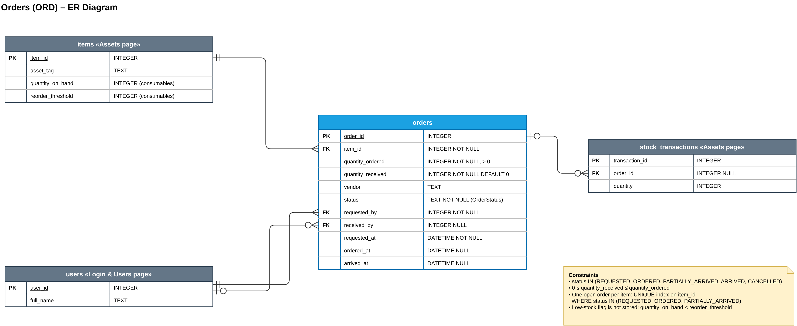
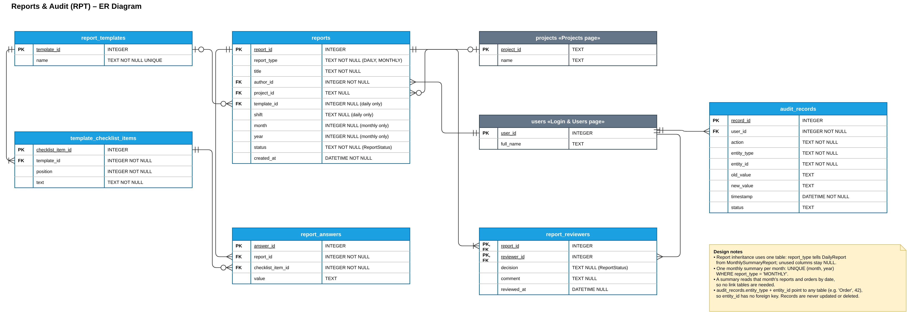

# SP6 – Database Design (ER): Orders and Reports & Audit

**Designer:** Duong Anh Nguyen (Tom)
**Files:** `ORD-RPT-er.drawio` (2 pages), `ORD-er.png`, `RPT-er.png`, `ORD-RPT-schema.sql`
**Database:** SQLite

Blue tables belong to these pages. Grey tables belong to other pages and show only the columns referenced here.

## 1. Orders (ORD)

| Table | Purpose |
|---|---|
| `orders` | One row per order for new stock |

| Relationship | Cardinality | Foreign key |
|---|---|---|
| items → orders | 1 item has 0..* orders | `orders.item_id` |
| users → orders (requested) | 1 user requests 0..* orders | `orders.requested_by` |
| users → orders (received) | an order has 0..1 receiver | `orders.received_by` (nullable) |
| orders → stock_transactions | 1 order creates 0..* stock-in rows | `stock_transactions.order_id` (Assets page, nullable) |

**Rules enforced in the database**
- `status` is one of `REQUESTED`, `ORDERED`, `PARTIALLY_ARRIVED`, `ARRIVED`, `CANCELLED`.
- `quantity_ordered > 0` and `0 ≤ quantity_received ≤ quantity_ordered`.
- One open order per item: a partial unique index on `item_id` for open statuses.
- The low-stock flag is not stored; it is computed as `quantity_on_hand < reorder_threshold`.

## 2. Reports & Audit (RPT)

| Table | Purpose |
|---|---|
| `reports` | All reports; `report_type` = `DAILY` or `MONTHLY` |
| `report_templates` | Reusable daily report templates |
| `template_checklist_items` | The checklist lines of a template, in order |
| `report_answers` | A daily report's answer for each checklist line |
| `report_reviewers` | Reviewers of a report, with their decision and comment |
| `audit_records` | Every change in the system, from all pages |

| Relationship | Cardinality | Foreign key |
|---|---|---|
| users → reports (author) | 1 user writes 0..* reports | `reports.author_id` |
| projects → reports | a report belongs to 0..1 project | `reports.project_id` (nullable) |
| report_templates → reports | a daily report comes from 0..1 template | `reports.template_id` (nullable) |
| report_templates → template_checklist_items | 1 template has 1..* lines | `template_checklist_items.template_id` |
| reports → report_answers | 1 report has 0..* answers | `report_answers.report_id` |
| template_checklist_items → report_answers | 1 line has 0..* answers | `report_answers.checklist_item_id` |
| reports ↔ users (reviewers) | many-to-many | `report_reviewers` (composite PK) |
| users → audit_records | 1 user makes 0..* records | `audit_records.user_id` |

**Design decisions**
- **Inheritance:** `Report`, `DailyReport`, and `MonthlySummaryReport` share one table. `report_type` tells them apart; daily-only and monthly-only columns stay NULL. Check constraints require `month`/`year` for monthly reports only.
- **One summary per month:** a partial unique index on `(month, year)` for monthly reports.
- **Monthly summary contents:** read from `reports` and `orders` by date, so no link tables are needed.
- **Normalization:** the template checklist (`List<str>`) and the answers (`dict`) are separate tables, so each column holds one value (1NF).
- **Audit records:** `entity_type` + `entity_id` can point to any table, so `entity_id` has no foreign key. Triggers block every `UPDATE` and `DELETE`.

## Class → table mapping

| Class (SP5) | Table |
|---|---|
| `Order`, `OrderStatus` | `orders` (`status` column) |
| `Report`, `DailyReport`, `MonthlySummaryReport`, `ReportStatus` | `reports` |
| `ReportTemplate` | `report_templates` + `template_checklist_items` |
| `DailyReport.checklistAnswers` | `report_answers` |
| `Report.reviewers` | `report_reviewers` |
| `AuditRecord`, `AuditLog` | `audit_records` |
| `OrderManager`, `StockMonitor`, `ReportManager`, `SummaryGenerator` | none (services, no stored data) |
