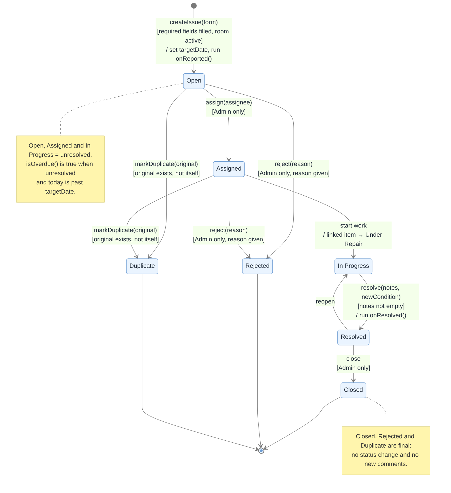
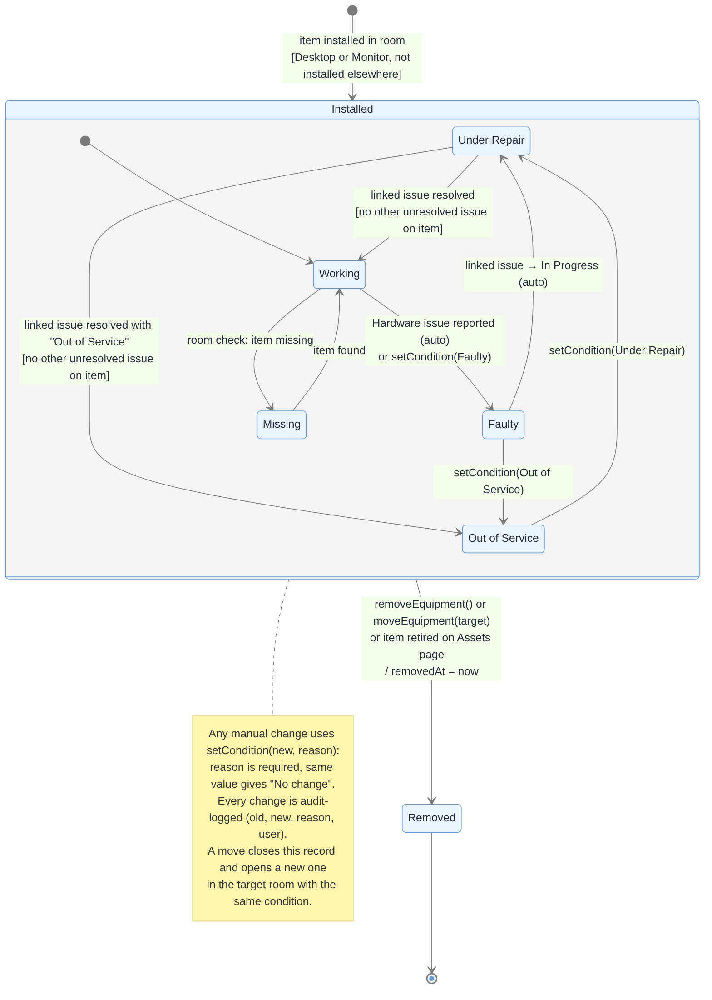
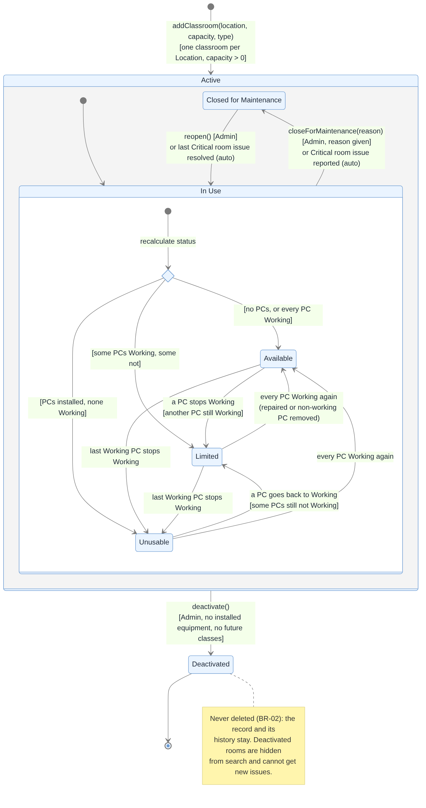
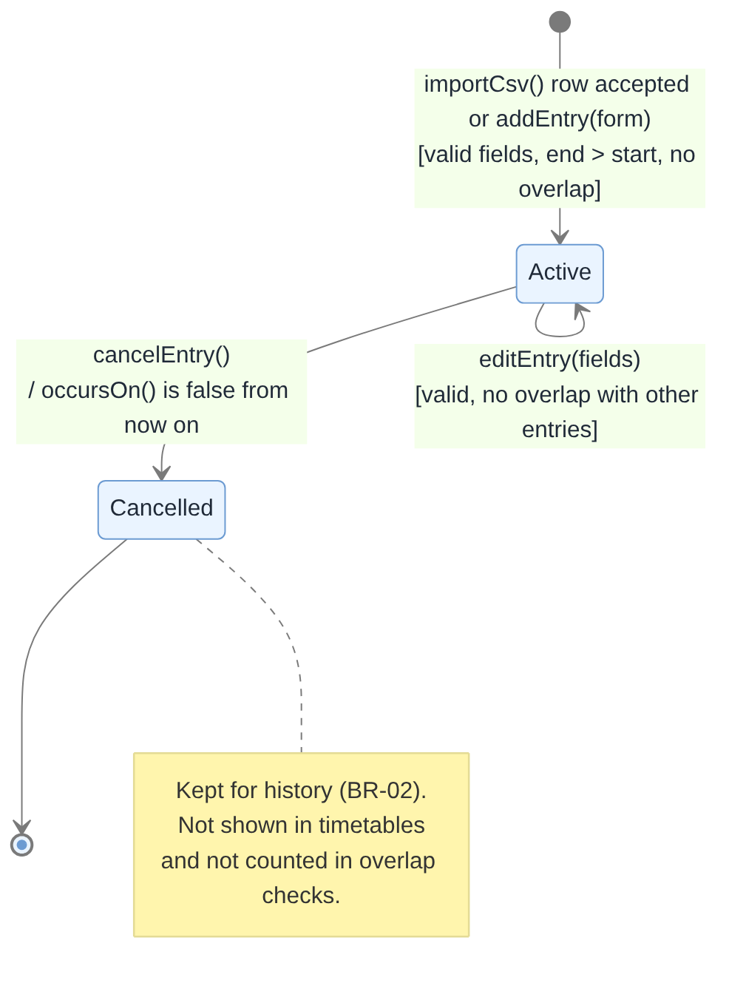

# SP7 – State Diagrams: Classrooms & Schedules (CLS) and Issue Logs (ISS)

**Designer:** Nusratilloh Soliev (@nusratillokh-dev)
**Files:** `CLS-ISS-issue-state.mmd/.png`, `CLS-ISS-equipment-state.mmd/.png`, `CLS-ISS-classroom-state.mmd/.png`, `CLS-ISS-schedule-entry-state.mmd/.png`
**Notation:** UML state machine, drawn in Mermaid (`stateDiagram-v2`). Transition labels read `event [guard] / action`.
**Source:** SP4 `docs/sp4-system-design/CLS-ISS/CLS-ISS-system-design.md` §5, §9 and §11 and `diagrams/issue-state-diagram.puml`; SP2 BR-02, BR-18, BR-19, BR-23, A-07, DD-CLS-01, DD-CLS-02 and DD-ISS-01. This document refines the SP4 issue state diagram and adds the other stateful classes. IDs use the merged SP2/SP3 numbering, as in SP4.

## Contents

1. [Which classes need a state diagram](#1-which-classes-need-a-state-diagram)
2. [Issue](#2-issue)
3. [Room Equipment (installed PC or monitor)](#3-room-equipment-installed-pc-or-monitor)
4. [Classroom](#4-classroom)
5. [Schedule Entry](#5-schedule-entry)
6. [How the state machines work together](#6-how-the-state-machines-work-together)
7. [Traceability](#7-traceability)

---

## 1. Which classes need a state diagram

A class gets a state diagram when its behaviour depends on its current status: some actions are allowed in one state and refused in another. In the CLS and ISS pages these are:

| Class | State attribute | Why it needs a diagram |
|---|---|---|
| `Issue` | `status : IssueStatus` | Fixed list of allowed transitions, role checks and final states (BR-23) |
| `RoomEquipment` | `condition : EquipmentCondition`, `removedAt` | Condition changes both by hand and automatically from issues (DD-ISS-01) |
| `Classroom` | `isActive`, `closedForMaintenance`, derived `RoomStatus` | Status is derived from equipment, with an Admin override (DD-CLS-02) |
| `ScheduleEntry` | `status : EntryStatus` | Cancelled entries are kept but leave timetables and overlap checks (BR-19) |

Classes with no real lifecycle are left out: `RoomCheck`, `RoomCheckResult`, `ScheduleImport` and `IssueUpdate` are written once and never change (append-only records).

---

## 2. Issue

An issue is one problem reported in a classroom, optionally for one installed PC or monitor. Its status moves only through `Issue.changeStatus()` and the helper methods `assign()`, `resolve()` and `markDuplicate()`. The status menu on the issue page shows only `allowedNextStatuses(user)`, so the user never sees a move the diagram does not allow.

Source: [`CLS-ISS-issue-state.mmd`](CLS-ISS-issue-state.mmd)

### States

| State | Meaning | Unresolved? | Final? |
|---|---|---|---|
| Open | Recorded by an SA, not yet given to anyone | Yes | No |
| Assigned | The Admin has given it to a person | Yes | No |
| In Progress | Someone is working on it | Yes | No |
| Resolved | Fixed, with resolution notes; waiting for the Admin to close it | No | No |
| Closed | Confirmed fixed by the Admin | No | Yes |
| Rejected | Not a real problem or out of scope (reason required) | No | Yes |
| Duplicate | Same problem as another issue, linked to the original | No | Yes |

### Transitions

| From | Event | Guard | Action | To |
|---|---|---|---|---|
| (start) | `createIssue(form)` | classroom active, item installed in it, required fields filled (BR-21) | new ID, `createdBy`/`createdAt`, `targetDate` from severity (BR-22), run `onReported()` effect | Open |
| Open | `assign(assignee)` | Admin only, assignee given | `IssueUpdate` added | Assigned |
| Assigned | start work | SA or Admin | linked item → Under Repair (`onStarted()`) | In Progress |
| In Progress | `resolve(notes, newCondition)` | notes not empty | `resolvedBy`/`resolvedAt` set, run `onResolved()` effect | Resolved |
| Resolved | reopen | SA or Admin | `IssueUpdate` added | In Progress |
| Resolved | close | Admin only | `IssueUpdate` added | Closed |
| Open or Assigned | `reject(reason)` | Admin only, reason comment given | `IssueUpdate` added | Rejected |
| Open or Assigned | `markDuplicate(original)` | original exists and is not the same issue | link to root original; repeat-problem check (> 3 reports) | Duplicate |

### Refused moves

- Any move not in the table (for example Open → Closed or In Progress → Rejected) gives "This status change is not allowed."
- An SA trying an Admin-only move gets "Not allowed for your role."
- In a final state (Closed, Rejected, Duplicate) no status change and no new comment is accepted: "This issue is closed. Comments are not allowed."
- Every accepted move appends an `IssueUpdate` with old status, new status, user and time; the history is never edited (NFR-ISS-04).

---

## 3. Room Equipment (installed PC or monitor)

A `RoomEquipment` record links one AST `Item` (category Desktop or Monitor) to a classroom. Its condition is separate from the AST `ItemStatus` (DD-CLS-01). The record lives from installation until the item is removed, moved or retired; it is then kept as history.

Source: [`CLS-ISS-equipment-state.mmd`](CLS-ISS-equipment-state.mmd)

### States

| State | Meaning |
|---|---|
| Installed | Composite state: the item is in the room (`removedAt = None`) |
| Working | Works normally – the only condition that counts as a working PC for the room status |
| Faulty | Has a known problem, usually from a Hardware issue |
| Under Repair | Someone is fixing it (its issue is In Progress) |
| Out of Service | Cannot be used and is not being repaired now |
| Missing | Not found in the room during a check |
| Removed | No longer installed; the record stays as history |

### Transitions

| From | Event | Guard | Action | To |
|---|---|---|---|---|
| (start) | item installed in room | Desktop or Monitor, not installed in another room | `installedAt` set | Installed / Working |
| Working | Hardware issue reported on this item (auto) or `setCondition(Faulty)` | item is Working (the auto rule only changes a Working item) | audit record with issue ID | Faulty |
| Faulty | linked issue moves to In Progress (auto) | – | audit record with issue ID | Under Repair |
| Under Repair | linked issue resolved | no other unresolved issue on the item (FR-ISS-09) | chosen condition, default Working | Working |
| Under Repair | linked issue resolved with "Out of Service" | no other unresolved issue on the item | audit record | Out of Service |
| Faulty | `setCondition(Out of Service, reason)` | reason given | audit record | Out of Service |
| Out of Service | `setCondition(Under Repair, reason)` | reason given | audit record | Under Repair |
| Working | room check finds the item missing | reason given | `setCondition(Missing, "Room check <id>: …")` | Missing |
| Missing | item found | reason given | `setCondition(Working, reason)` | Working |
| Installed (any condition) | `removeEquipment()`, `moveEquipment(target)` or item retired on the Assets page | – | `removedAt = now`; a move opens a new record in the target room with the same condition | Removed |

### Rules shown in the note

- The diagram shows the usual paths. The SA can also correct a condition by hand with `setCondition(new, reason)`; a reason is required and choosing the same condition gives "No change" and saves nothing (US-CLS-03).
- If another unresolved issue still points at the item, resolving one issue does not change the condition (US-ISS-05).
- Every condition change, manual or automatic, writes an audit record with old value, new value, reason, user and time, in the same transaction as the issue change (NFR-ISS-05).
- After every change the classroom status is recalculated (Section 4).

---

## 4. Classroom

A classroom is one Location (building + room). It is active from creation until the Admin deactivates it. While active, its status is either **Closed for Maintenance** (an override) or one of three statuses **derived** from its installed PCs by `RoomStatusCalculator`.

Source: [`CLS-ISS-classroom-state.mmd`](CLS-ISS-classroom-state.mmd)

### States

| State | Meaning |
|---|---|
| Active | Composite state: `isActive = true`; shown in lists and search, can get issues and classes |
| In Use | Composite state inside Active: not closed, so the status is derived |
| Available | No PCs installed, or every installed PC is Working |
| Limited | At least one PC Working and at least one not Working |
| Unusable | PCs are installed and none is Working |
| Closed for Maintenance | Admin override or a Critical room issue; overrides the derived status |
| Deactivated | `isActive = false`; kept for history, hidden from search, no new issues |

Only Desktop items count as PCs. Monitors are shown on the page but do not change the room status.

### Transitions

| From | Event | Guard | Action | To |
|---|---|---|---|---|
| (start) | `addClassroom(location, capacity, type)` | one classroom per Location (BR-18), capacity > 0 | new ID, audit record | Active / In Use |
| entering In Use | recalculate status (choice) | depends on PC conditions | – | Available, Limited or Unusable |
| Available | a PC stops Working | another PC still Working | – | Limited |
| Available | the last Working PC stops Working | – | – | Unusable |
| Limited | every PC Working again (repaired, or non-working PC removed) | – | – | Available |
| Limited | the last Working PC stops Working | – | – | Unusable |
| Unusable | a PC goes back to Working | some PCs still not Working | – | Limited |
| Unusable | every PC Working again | – | – | Available |
| In Use | `closeForMaintenance(reason)` or Critical room issue reported (auto) | Admin and reason given (manual) | `closedReason` set, audit record | Closed for Maintenance |
| Closed for Maintenance | `reopen()` or last Critical room issue resolved (auto) | Admin (manual); no other unresolved Critical room issue (auto) | status recalculated on entry | In Use |
| Active | `deactivate()` | Admin, no installed equipment, no future classes (BR-18) | `isActive = false`, audit record | Deactivated |

A deactivation that breaks the guard is refused with a message naming the reason (equipment still installed or future classes scheduled). Classrooms are never deleted (BR-02).

---

## 5. Schedule Entry

A schedule entry is one weekly class meeting in a classroom, created by the registrar CSV import or by hand.

Source: [`CLS-ISS-schedule-entry-state.mmd`](CLS-ISS-schedule-entry-state.mmd)

| From | Event | Guard | Action | To |
|---|---|---|---|---|
| (start) | CSV row accepted by `importCsv()` or `addEntry(form)` | required fields, end > start, termEnd ≥ termStart, no overlap (BR-19) | source IMPORT or MANUAL, audit record | Active |
| Active | `editEntry(fields)` | still valid, no overlap with other entries (itself ignored) | audit record | Active |
| Active | `cancelEntry()` | – | `occursOn()` is false from now on; audit record | Cancelled |

A Cancelled entry stays in the database (BR-02) but is not shown in timetables and is not counted in overlap checks.

---

## 6. How the state machines work together

The four machines are linked by events, all saved in one transaction by `UnitOfWork` (NFR-ISS-05):

| Event in one machine | Effect in another machine | Rule |
|---|---|---|
| Hardware issue on an item → **Open** | item **Working → Faulty** | DD-ISS-01 (`HardwareItemEffect.onReported`) |
| Issue → **In Progress** | item → **Under Repair** | DD-ISS-01 (`onStarted`) |
| Issue → **Resolved** | item → chosen condition, if no other unresolved issue on it | FR-ISS-09 (`onResolved`) |
| Critical issue with no item → **Open** | classroom → **Closed for Maintenance** | DD-ISS-01 (`CriticalRoomEffect`) |
| Last Critical room issue → **Resolved** | classroom → **In Use** (status recalculated) | DD-ISS-01 |
| Any PC condition change | classroom recalculates Available / Limited / Unusable | DD-CLS-02 |
| Classroom → **Deactivated** | not allowed while equipment is Installed or entries are Active in the future | BR-18 |

---

## 7. Traceability

| Diagram | Requirements | User stories | Class methods (SP4 §5) |
|---|---|---|---|
| Issue | BR-21, BR-22, BR-23, FR-ISS-08, NFR-ISS-04 | US-ISS-01, 03, 05, 06, 07 | `Issue.create`, `changeStatus`, `assign`, `resolve`, `markDuplicate`, `allowedNextStatuses`, `isFinal`, `isUnresolved`, `isOverdue` |
| Room Equipment | A-07, DD-CLS-01, DD-ISS-01, FR-ISS-09 | US-CLS-02, 03, 04, US-ISS-05 | `RoomEquipment.setCondition`, `remove`, `isInstalled` |
| Classroom | BR-18, BR-20, DD-CLS-02 | US-CLS-01, 03, US-ISS-05 | `Classroom.closeForMaintenance`, `reopen`, `deactivate`; `RoomStatusCalculator` |
| Schedule Entry | BR-19, BR-02 | US-CLS-06, 07, 08 | `ScheduleEntry.validate`, `overlaps`, `update`, `cancel`, `occursOn` |
