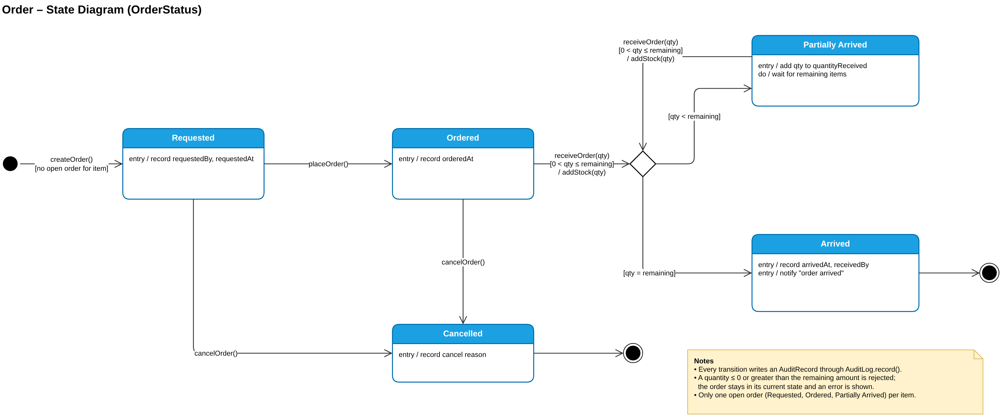
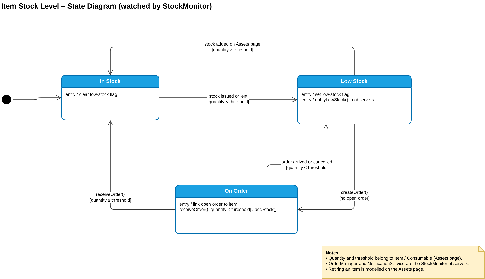
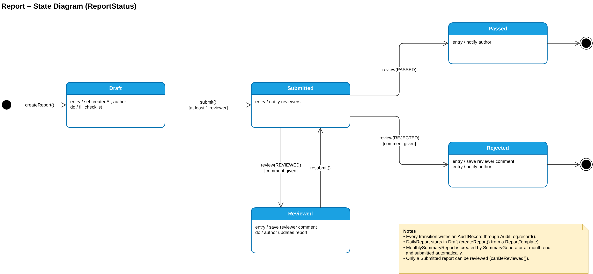

# SP7 – State Diagrams: Orders and Reports & Audit

**Designer:** Duong Anh Nguyen (Tom)
**Source files:** `ORD-states.drawio` (2 pages), `RPT-states.drawio` (1 page)

## 1. Order (OrderStatus)

| From | Event [guard] / action | To |
|---|---|---|
| ● (start) | `createOrder()` [no open order for item] | Requested |
| Requested | `placeOrder()` | Ordered |
| Requested | `cancelOrder()` | Cancelled |
| Ordered | `cancelOrder()` | Cancelled |
| Ordered, Partially Arrived | `receiveOrder(qty)` [0 < qty ≤ remaining] / `addStock(qty)` | ◇ choice |
| ◇ choice | [qty < remaining] | Partially Arrived |
| ◇ choice | [qty = remaining] | Arrived |
| Arrived, Cancelled | — | ◉ (end) |

## 2. Item stock level (watched by StockMonitor)

| From | Event [guard] / action | To |
|---|---|---|
| ● (start) | — | In Stock |
| In Stock | stock issued or lent [quantity < threshold] | Low Stock |
| Low Stock | `createOrder()` [no open order] | On Order |
| On Order | `receiveOrder()` [quantity ≥ threshold] | In Stock |
| On Order | order arrived or cancelled [quantity < threshold] | Low Stock |
| Low Stock | stock added on Assets page [quantity ≥ threshold] | In Stock |

## 3. Report (ReportStatus)

| From | Event [guard] / action | To |
|---|---|---|
| ● (start) | `createReport()` | Draft |
| Draft | `submit()` [at least 1 reviewer] | Submitted |
| Submitted | `review(PASSED)` | Passed |
| Submitted | `review(REJECTED)` [comment given] | Rejected |
| Submitted | `review(REVIEWED)` [comment given] | Reviewed |
| Reviewed | `resubmit()` | Submitted |
| Passed, Rejected | — | ◉ (end) |

## Objects without states

- **AuditRecord** is created once and never changes (it cannot be edited or deleted), so it has no state diagram.
- **ReportTemplate** has no lifecycle states.

## Notation

| Symbol | Meaning |
|---|---|
| ● | Initial state |
| ◉ | Final state |
| ◇ | Choice (decision on a guard) |
| `event [guard] / action` | Transition: trigger, condition, and action |
| `entry /`, `do /` | Action on entering the state, activity while in it |
