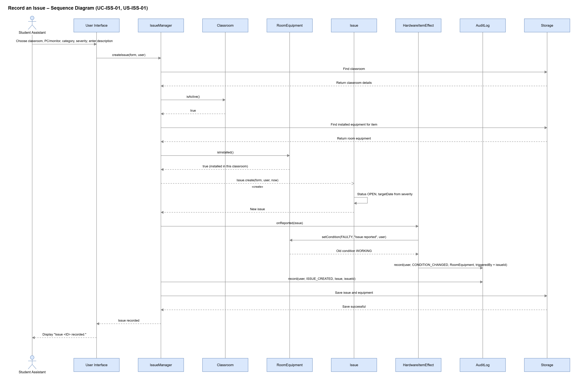
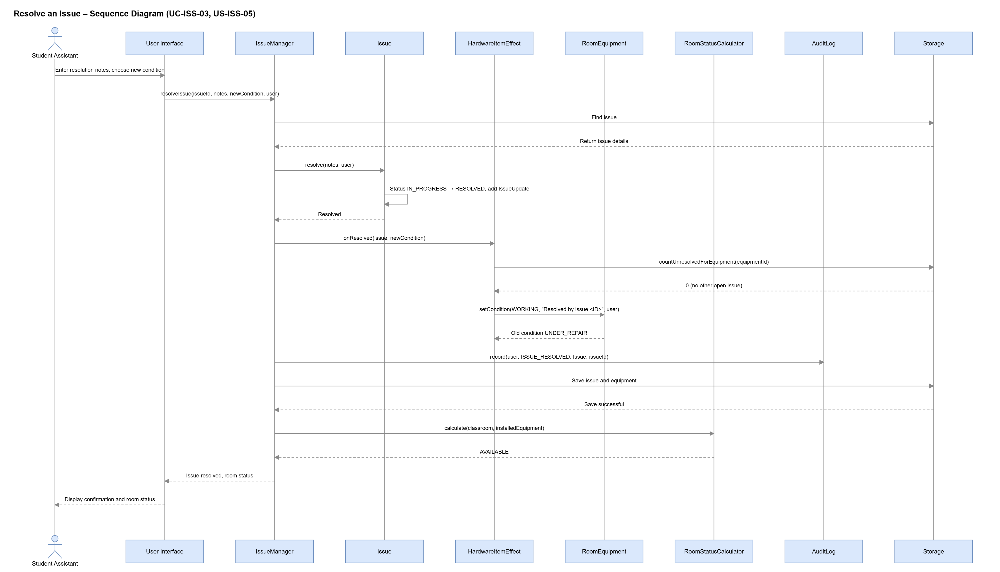
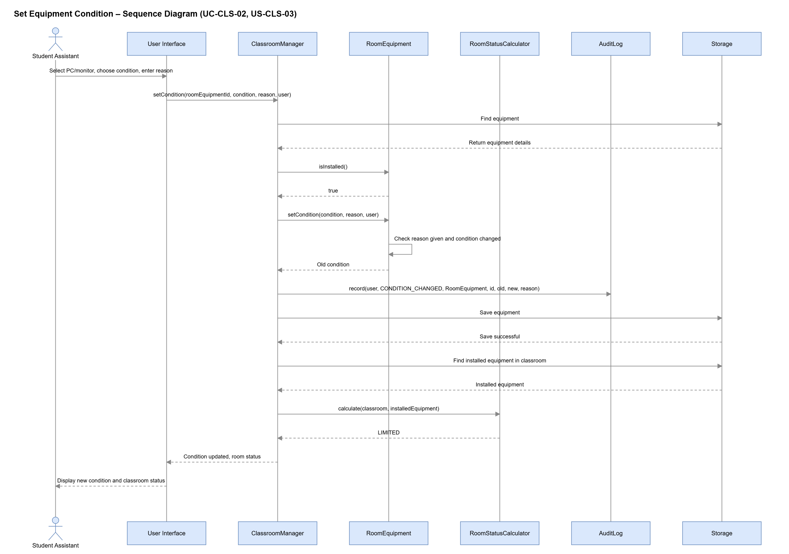
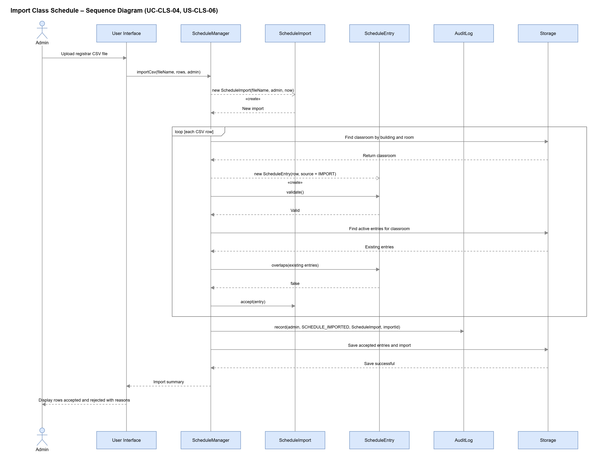

# SP8 – Sequence Diagrams: Classrooms & Schedules (CLS) and Issue Logs (ISS)

**Designer:** Nusratilloh Soliev (@nusratillokh-dev)
**Files:** `CLS-ISS-sequences.drawio` (4 pages), PNG exports `ISS-record-issue-seq.png`, `ISS-resolve-issue-seq.png`, `CLS-set-condition-seq.png`, `CLS-import-schedule-seq.png`
**Notation:** UML sequence diagram, drawn in draw.io in the same style as the other SP8 diagrams. Solid arrow = call, dashed arrow = return, dashed open arrow with «create» = object creation, arrow back to the same lifeline = internal step.
**Source:** SP4 `docs/sp4-system-design/CLS-ISS/` (classes and methods), SP6 `CLS-ISS-db-design.md` (what is saved), SP7 `CLS-ISS-state-diagrams.md` (status changes). IDs use the merged SP2/SP3 numbering.

Each diagram shows the **main success path** of one use case. Error paths (missing fields, wrong role, item not installed, save failure with rollback) are listed under each diagram and are drawn in full in the SP4 PlantUML sequences.

## Contents

1. [Record an Issue (UC-ISS-01)](#1-record-an-issue-uc-iss-01)
2. [Resolve an Issue (UC-ISS-03)](#2-resolve-an-issue-uc-iss-03)
3. [Set Equipment Condition (UC-CLS-02)](#3-set-equipment-condition-uc-cls-02)
4. [Import Class Schedule (UC-CLS-04)](#4-import-class-schedule-uc-cls-04)
5. [Participants](#5-participants)
6. [Traceability](#6-traceability)

---

## 1. Record an Issue (UC-ISS-01)

A Student Assistant reports a hardware problem on one PC in a classroom. The new issue starts as **Open**, and the PC's condition changes **Working → Faulty** automatically (DD-ISS-01).

Main steps:

1. The SA fills in the issue form; the page calls `IssueManager.createIssue(form, user)`.
2. `IssueManager` loads the classroom and checks `isActive()`, then loads the room equipment and checks `isInstalled()` in that classroom (BR-21).
3. `Issue.create()` sets status OPEN, `createdBy`, `createdAt` and `targetDate` from the severity (BR-22).
4. `HardwareItemEffect.onReported()` sets the PC to FAULTY and writes an audit record that points to the issue.
5. The issue creation is audited, the issue and equipment are saved in one transaction (NFR-ISS-05), and the page shows "Issue <ID> recorded."

Other paths (not drawn): classroom missing or inactive → "Classroom not found or inactive."; item not in this classroom → "Item is not installed in this classroom."; required field empty → message next to the field; save fails → rollback and "Issue could not be saved. Please try again."

---

## 2. Resolve an Issue (UC-ISS-03)

A Student Assistant resolves an issue that is **In Progress**. If no other unresolved issue points to the same PC, the PC returns to the chosen condition (default Working) and the classroom status is recalculated (FR-ISS-09, DD-CLS-02).

Main steps:

1. The SA enters resolution notes and a new condition; the page calls `IssueManager.resolveIssue(issueId, notes, newCondition, user)`.
2. `Issue.resolve()` moves the status IN_PROGRESS → RESOLVED and adds an `IssueUpdate` (BR-23, NFR-ISS-04).
3. `HardwareItemEffect.onResolved()` counts other unresolved issues on the PC; the result is 0, so it calls `RoomEquipment.setCondition(WORKING, ...)`.
4. The resolution is audited and saved, then `RoomStatusCalculator.calculate()` returns the new room status (here AVAILABLE), which the page shows with the confirmation.

Other paths (not drawn): issue not In Progress → "Only an In Progress issue can be resolved."; notes empty → "Resolution notes are required."; another unresolved issue on the PC → condition is left unchanged; save fails → rollback, nothing changed.

---

## 3. Set Equipment Condition (UC-CLS-02)

A Student Assistant changes the condition of an installed PC or monitor by hand, for example after a room check.

Main steps:

1. The SA selects the PC, chooses a condition and enters a reason; the page calls `ClassroomManager.setCondition(roomEquipmentId, condition, reason, user)`.
2. `ClassroomManager` loads the equipment and checks `isInstalled()`.
3. `RoomEquipment.setCondition()` checks that a reason is given and that the condition really changes, then returns the old condition (US-CLS-03).
4. The change is audited with old value, new value and reason (NFR-CLS-01), saved, and the classroom status is recalculated from its installed equipment (here LIMITED).

Other paths (not drawn): equipment not installed → "Equipment is not installed in a classroom."; reason empty → "Reason is required."; same condition → "No change." and nothing is saved.

---

## 4. Import Class Schedule (UC-CLS-04)

The Admin uploads the registrar's CSV file. Every row becomes a `ScheduleEntry` (source IMPORT) if it is valid and does not overlap another class in the same room (BR-19).

Main steps:

1. The Admin uploads the CSV; the page calls `ScheduleManager.importCsv(fileName, rows, admin)`.
2. `ScheduleManager` creates a `ScheduleImport` record for this upload.
3. In a **loop** over the rows: find the classroom by building and room, create a `ScheduleEntry`, call `validate()`, load the room's active entries and call `overlaps()`. A valid row is passed to `ScheduleImport.accept(entry)`.
4. After the loop the import is audited, accepted entries and the import record are saved, and the page shows how many rows were accepted and rejected, with the reason for each rejected row.

Other paths (not drawn): user is not Admin → "Not allowed."; wrong file type or header → "File must be a CSV with the expected columns."; unknown room, bad field, end ≤ start or overlap → `ScheduleImport.reject(rowNumber, reason)` and the row is listed as rejected.

---

## 5. Participants

| Participant | Kind | Role in the diagrams |
|---|---|---|
| Student Assistant, Admin | Actor | Start the use case from the page |
| User Interface | Boundary | Classroom, issue and schedule pages |
| IssueManager, ClassroomManager, ScheduleManager | Control | Use-case logic from SP4 §5 |
| Issue, RoomEquipment, Classroom, ScheduleEntry, ScheduleImport | Entity | Domain objects from the SP5/SP6 design |
| HardwareItemEffect | Strategy | `IssueEffect` used when an issue on a PC/monitor is reported or resolved (DD-ISS-01) |
| RoomStatusCalculator | Service | Derives Available / Limited / Unusable from installed PCs (DD-CLS-02) |
| AuditLog | Shared (RPT) | Append-only audit records |
| Storage | Repository + UnitOfWork | Loads and saves records in one transaction (SP6 schema) |

## 6. Traceability

| Diagram | Use case | User stories | Requirements | SP7 state changes shown |
|---|---|---|---|---|
| Record an Issue | UC-ISS-01 | US-ISS-01 | FR-ISS-01–03, BR-21, BR-22, DD-ISS-01, NFR-ISS-05 | Issue → Open; RoomEquipment Working → Faulty |
| Resolve an Issue | UC-ISS-03 | US-ISS-05 | FR-ISS-07, FR-ISS-09, BR-23, NFR-ISS-04, NFR-ISS-05 | Issue In Progress → Resolved; RoomEquipment Under Repair → Working; Classroom recalculated |
| Set Equipment Condition | UC-CLS-02 | US-CLS-03 | FR-CLS-03, FR-CLS-04, NFR-CLS-01 | RoomEquipment condition change; Classroom recalculated |
| Import Class Schedule | UC-CLS-04 | US-CLS-06 | FR-CLS-06, BR-19, A-09 | ScheduleEntry → Active |
